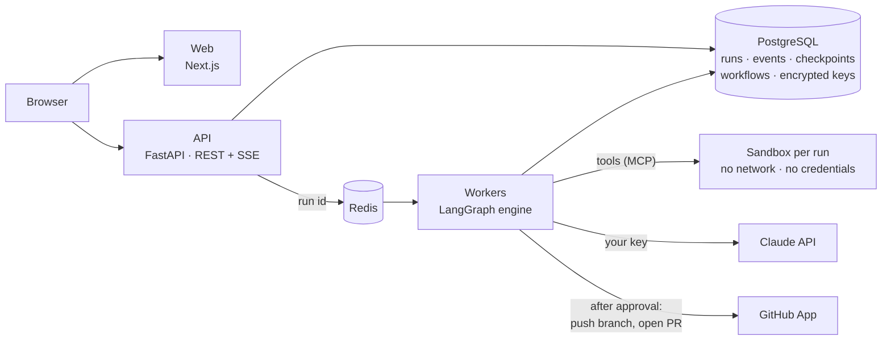

# Agentic Dev Platform

**Design, run and trust AI agent workflows on your own repositories.** Draw the orchestration you need from a few composable primitives, run it on your own model key in an isolated sandbox, approve every change before it leaves, and receive the result as a pull request.

[](LICENSE)


> [!IMPORTANT]
> **Pre-1.0 and not yet multi-user.** The API has no built-in authentication. Run it on your machine, or behind an authenticating proxy on a private network. Read the [security model](docs/security/security-model.md) before deploying it for a team.

---

## Why

Each kind of engineering work needs a different shape of agent work: documentation is a fan-out over modules, an audit is parallel scanners and reviewers merged and voted on, and a feature is a spec, an approval, implementation and review loops. Single-agent tools run one loop; workflow builders don't understand code.

This platform does both:

- **Open orchestration.** Workflows are graphs of primitives (`agent`, `tool`, `sequence`, `parallel`, `map`, `reduce`, `router`, `loop`, `gate`), not a fixed menu of patterns. Build them on a canvas, version them, diff and restore them.
- **Code-aware.** Agents work on a sandboxed clone of your repo through platform tools (read, write on their own branch, lint, secret and dependency scanning), whatever the model provider.
- **Humans approve irreversible actions.** Pushing, opening a PR and creating a repo always wait at a gate, where an approver reviews the diff and can edit it. Approvals expire. The platform never merges.
- **Bring your own access.** Your GitHub App, your model keys, your prices and limits. Nothing is shared with anyone else.
- **Transparent and accountable.** Every agent turn, tool call, artifact, approval and cent is recorded in an append-only log you can watch live.

## What you can do today

| | |
|---|---|
| **Generate docs** | Document every module of a repo and open a PR with the result, after your approval. |
| **Audit a codebase** | Run linters, secret and dependency scanners and voted reviewer agents in parallel, merge the findings, and get `findings.json` plus a readable report. Read-only. |
| **New repo** | Create an organisation repo behind a gate and run a workflow on it. |
| **Build your own workflow** | Start from a template or a blank canvas; edit nodes in a schema-driven side panel with live validation; save immutable versions; run any version. |
| **Operate it** | Runs list and live console, an Inbox for approvals, cancel and rerun, budgets and limits, per-model pricing, and an audit log. |

Planned: dynamic orchestration with a hub agent that spawns workers, composite nodes, spec-driven development from Jira, GitHub Copilot as a second provider, the **Flow Architect** agent that drafts workflows from a goal, and plugin nodes. See the [roadmap](specs/roadmap.md).

## How it works



A workflow is a versioned JSON spec. The API validates it and queues a run; a worker claims it, compiles it to a LangGraph graph and executes it, checkpointing every node in Postgres so a crashed worker's run resumes elsewhere. Agents act on the repo only through platform-owned tools inside a sandbox with no network. Commits leave the sandbox as a git bundle and are pushed by the worker, only after a human approves. Read more in the [architecture overview](docs/architecture/overview.md).

## Quick start

Requirements: Docker with Compose v2.

```bash
git clone https://github.com/<your-account>/agentic-dev.git
cd agentic-dev
cp .env.example .env
docker compose up --build
```

Open <http://localhost:3000>. Out of the box, agents run on a **fake runtime** (scripted, offline, free), so you can explore every screen at no cost. To run real agents:

1. Set `AGENTIC_RUNTIME=claude` in `.env` and restart the worker.
2. In **Settings → Integrations**, paste your Anthropic API key (stored encrypted).
3. Register your own GitHub App and install it on a test repository ([how](docs/integrations/connecting-platforms.md#1-github-register-your-own-github-app)). Or set `AGENTIC_GITHUB=fake` to use two local demo repos.
4. Go to **Templates**, pick **Generate docs** or **Audit codebase**, choose a repo and start.

API documentation is served at <http://localhost:8000/docs>.

## Documentation

| | |
|---|---|
| [Architecture overview](docs/architecture/overview.md) | System context, containers, components, quality attributes |
| [Business flows](docs/architecture/business-flows.md) · [Technical flows](docs/architecture/technical-flows.md) | What users do, and what the system does for each step |
| [Architecture decisions](docs/architecture/decisions.md) | The key choices and why they were made |
| [Data model](docs/architecture/data-model.md) | Tables, relationships, invariants |
| [Security model](docs/security/security-model.md) | Threat model, controls, known gaps |
| [Deployment guide](docs/operations/deployment.md) · [Configuration](docs/operations/configuration.md) | Local, single host, production reference, every setting |
| [Connecting your platforms](docs/integrations/connecting-platforms.md) | Your GitHub App and model keys; adding providers, tools, sandboxes, KMS |
| [Getting started](docs/development/getting-started.md) · [Developer reference](docs/development/developer-reference.md) | Contributor setup and the phase-by-phase reference |

The project is built spec-first: [`specs/`](specs/) holds the [mission](specs/mission.md), the [roadmap](specs/roadmap.md), the [tech stack and decisions log](specs/tech-stack.md), the [design language](specs/design-language.md), and a dated folder planning each phase. Those files are binding: when the docs and the specs disagree, the specs win.

## Tech stack

**Backend:** Python 3.12, FastAPI, Pydantic v2, LangGraph with the Postgres checkpointer, SQLAlchemy 2 (async), Alembic, CEL, the MCP Python SDK, the Anthropic SDK, githubkit, docker-py; `uv` workspace of nine packages.
**Frontend:** Next.js (App Router), TypeScript, Tailwind CSS v4, shadcn/ui (Radix), TanStack Query, react-jsonschema-form, Monaco.
**Data:** PostgreSQL 16, Redis 7.
**Quality:** pytest and Testcontainers, pyright (strict), ruff, Vitest, Playwright with axe accessibility checks and layout screenshots at 375, 768 and 1440 px.

## Contributing

Contributions are welcome. Read [CONTRIBUTING.md](CONTRIBUTING.md) for the workflow (specs first, changelog on every PR, squash merges) and the [Code of Conduct](CODE_OF_CONDUCT.md). To report a security issue, follow [SECURITY.md](SECURITY.md) and do not open a public issue.

## License

Licensed under the [Apache License, Version 2.0](LICENSE).
