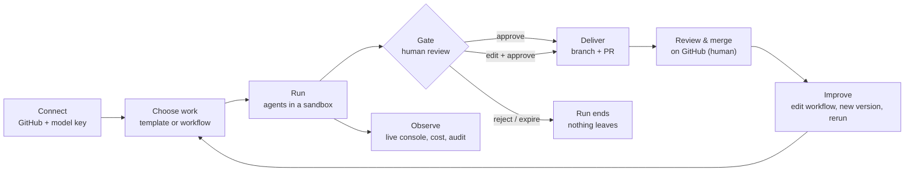
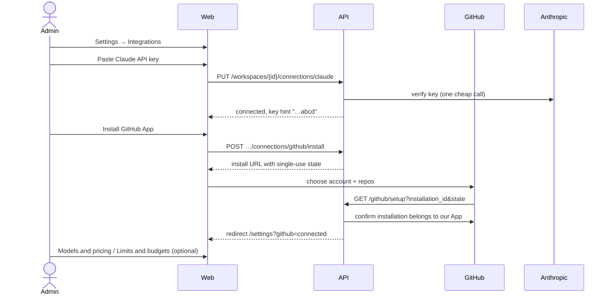
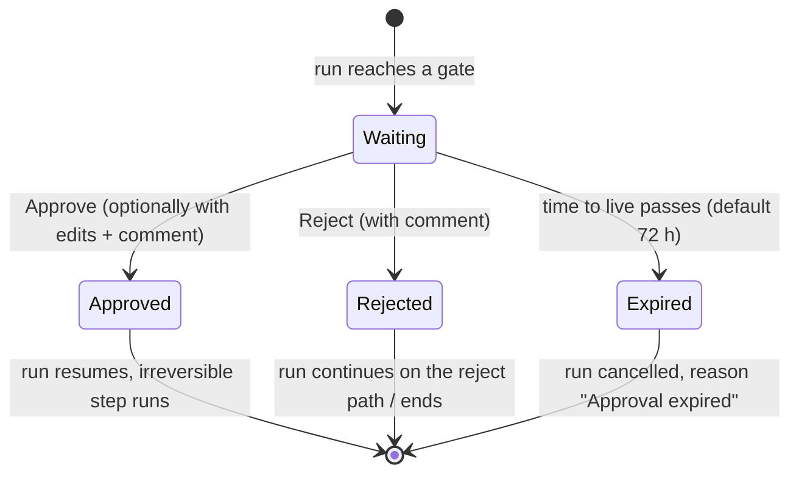
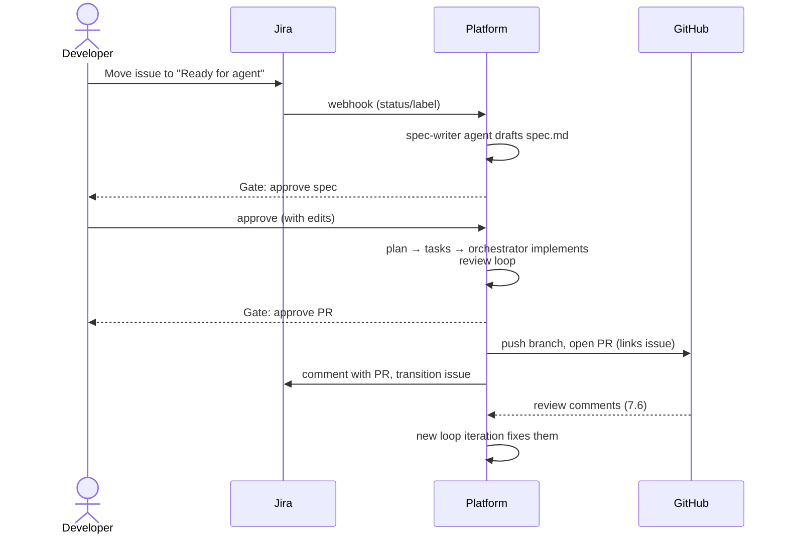

# Business flows

This document describes what people do with the platform: who they are, what they want, and the flows they go through from first setup to a merged pull request. Each flow notes what is **available now** and what is **planned** (with its [roadmap](../../specs/roadmap.md) phase). The system side of each step is in [Technical flows](technical-flows.md).

---

## 1. Actors

| Actor | Goal | Typical entry point |
|---|---|---|
| **Developer** | Get docs, an audit report or a pull request with little setup | Pick a template on the start screen and run it |
| **Tech lead** | Shape workflows to the team's process and reuse them across repos | Builder canvas: edit a workflow, keep versions |
| **Approver** (often the tech lead) | Decide whether an agent's change may leave the sandbox | Inbox: review the diff, edit, approve or reject |
| **Workspace admin** | Control cost, limits, credentials and see what happened | Settings (integrations, models and pricing, limits) and the audit log |
| **Platform operator** | Run the platform for an organisation | Deployment, the GitHub App, the master key, upgrades |
| **Agents** (non-human) | Do the work a node describes | Started by the engine with a role, instructions and a tool set |

---

## 2. Value stream at a glance

Two business rules shape every flow:

1. **Nothing irreversible happens without a person.** Pushing a branch, opening a PR and creating a repo always sit behind a `gate`. The platform never merges; a human merges on GitHub.
2. **Teams bring their own model access.** Each workspace stores its own model key and pays its provider directly; the platform tracks and caps the spend.

---

## 3. Flow: onboarding a workspace

**Actors:** workspace admin, platform operator. **Status:** available.

Business rules:

- The key is checked before it is stored, and only its last four characters are ever shown again.
- The GitHub App is installed on **chosen** repositories; the platform sees nothing else.
- Limits can only be **lowered** below the platform ceilings (8 agents alive, 40 spawned, depth 2, 5 loop iterations, 2 h active time, 72 h approval time to live). The budget is optional: unset means no cap, but cost is always tracked.
- Prices default to the provider's list prices; a workspace can override them (negotiated rates).

---

## 4. Flow: generate documentation (AC-1)

**Actors:** developer, approver, agents. **Status:** available (template `generate-docs`).

1. The developer opens **Templates**, picks **Generate docs**, selects a repo (or **New repo**), optionally a branch and options, and starts the run.
2. A deterministic tool node (`repo.list_modules`, no model) finds the repo's modules. A **map** runs one read-only agent per module, four at a time, each writing a Markdown page for its module.
3. A `concat` **reduce** joins the pages; a **writer** agent writes them with an index (by default `documentation/README.md`) and commits on its own branch `agent/<run>/<node>`.
4. The run pauses at a **gate**: "Open a pull request with these docs?" The approver sees the changed files as a diff, can **edit** them, then approves.
5. The platform pushes the branch and opens a **pull request**. The run console links to it.
6. The team reviews and merges on GitHub as usual.

Outcome: a PR with documentation, the cost of the run, and a full trace of every agent turn and tool call.

---

## 5. Flow: audit a codebase

**Actors:** developer, approver, agents. **Status:** available (template `audit-codebase`; read-only by default, fixes with the `fix` option).

```mermaid
flowchart LR
    subgraph S["checks: parallel (join: settled)"]
        L["scan.lint"]
        X["scan.secrets"]
        D["scan.dependencies"]
        R["Agent reviews<br/>security · tests · architecture<br/>(N reviewers + majority vote)"]
    end
    S --> M["merge: reduce dedupe<br/>→ findings.json"]
    M --> RT{"router on findings.json"}
    RT -- "nothing ≥ min severity" --> C["clean report"]
    RT -- "high / critical found" --> F["report with 'Fix first'"]
    RT -- "otherwise" --> W["standard report"]
    C & F & W --> O["report.md"]
    O -. "fix on" .-> G{{"gate: select findings"}}
    G -- "approve with a selection" --> OR["orchestrator: lead groups by file,<br/>fixers fix on task branches"]
    G -- "end run here" --> E["completed, no change"]
    OR --> IB["integration branch + fixes.md"]
    IB --> G2{{"gate: review the diff"}}
    G2 --> PR["github.openPR → one PR"]
```

Business rules:

- Without `fix`, the audit is **read-only**: its agents get only read tools, it has no writer, gate or `github.*` tool, and it opens no pull request.
- **The workflow's author chooses the checks.** A scanner runs only if the spec names it. `auto` lints each module with the linter the repo itself configured; a linter that cannot run offline is reported as *skipped*, never silently replaced.
- **Secrets never leave the sandbox:** the secret scanner reports rule, file and line, never the value.
- Findings from different scanners and reviewers are merged by fingerprint; the merged severity is the **highest** any source reported, and confidence is explainable ("2 of 3 reviewers").
- The audit reports what it could check and lists what it could not (a failed branch is a failed check, not a failed audit).
- **Fix selected findings (6.7):** with `fix`, the approver picks findings at a selection gate (critical and high checked); only those reach the lead, as data. Fixers change only their task's files, and nothing is pushed until a second gate approves the merged diff; the PR says what was fixed and what was not. Ending the run at the selection gate leaves the repo untouched and the audit completed.

---

## 6. Flow: approve, edit or reject at a gate

**Actors:** approver. **Status:** available.

- Every waiting gate appears in the **Inbox** with its time left, and in a sticky approval dock on the run console. Keyboard: `A` approve, `R` reject.
- Edits made at the gate are committed onto the writer's branch by the gate itself, so the PR contains exactly what the approver saw and changed. Both the original and the edits are recorded.
- Time waiting at a gate is **never** counted as the run's duration, nor against its wall-time limit.

---

## 7. Flow: design and evolve a workflow

**Actors:** tech lead. **Status:** available (Milestone 5); Flow Architect planned (Milestone 9).

1. Start from a template or a **Blank canvas**, choosing the model provider for the starter agent.
2. Edit on the canvas: add, move, replace and remove nodes from each card's menu; fill parameters in a side panel generated from the node's manifest. Incompatible ports are blocked as you edit; validation issues appear on the nodes.
3. **Save** creates a new immutable **version** that records the graph operations that produced it.
4. Browse the **history**, compare two versions as a visual diff, **restore** an old one (stored as a new version), or **run any version**.
5. A run records the exact workflow version and keeps a copy of the spec, so it can always be explained later.
6. **Composites (6.6):** pick a run of steps (a card's "Extract to composite…") to move them into a new workflow, called in their place; **publish** a version to offer it in every workflow's palette under "Workspace nodes". A caller keeps the version it calls until someone moves it with "Update to version N"; drafts are never called. "Wrap in…" puts steps in a new sequence, parallel, loop or map.

*Planned:* plugin nodes backed by a container or HTTP endpoint (10.1); the Flow Architect drafting a workflow from a goal and the repo's profile, and proposing edits as a reviewable diff (9.x).

---

## 8. Flow: monitor, cancel and rerun

**Actors:** developer, admin. **Status:** available.

- The **Runs** list shows every run with status, workflow, repo and branch, active duration, waiting time, cost and PR; saved views for *Running*, *Needs approval* and *Failed*.
- The **run console** shows a step list (or the graph) beside the selected step's output, activity (each agent turn as a readable work block), input, usage and raw events. Failures are named above the fold.
- **Cancel** stops a running or waiting run; its sandbox is removed.
- **Rerun** starts a new run with the same workflow, input and repo, linked to the original (`rerun_of`). History is never rewritten.

---

## 9. Flow: govern cost and risk

**Actors:** workspace admin. **Status:** available.

| Control | Effect |
|---|---|
| Budget (workspace default, per workflow, per run) | Hard stop when spend reaches 100%; the call that crossed it is counted in full. With a budget, every model must have a price or the run is refused. |
| Policy limits | Checked when the run is created and again while it runs; a run over a limit ends `failed` with a readable reason. |
| Approval time to live | A forgotten gate expires instead of waiting forever. |
| Audit log | Every settings change, run, approval and cancellation, with actor, time and details. Append-only. |
| Pricing table | Cost per node and run, priced once when used; changing a price never rewrites past runs. |

---

## 10. Planned flow: spec-driven development from Jira

**Status:** planned, Milestone 7.

Every code change stays traceable from the Jira issue to the spec, the run, the branch and the PR.
