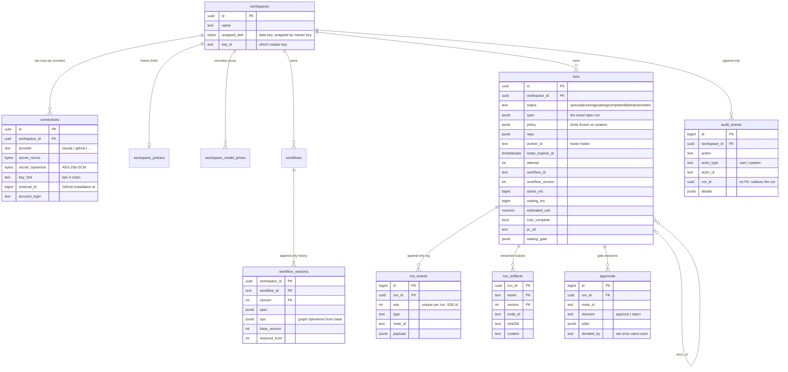

# Data model

PostgreSQL 16 is the system of record. The schema is defined by SQLAlchemy models in [`packages/store/src/agentic_store/models.py`](../../packages/store/src/agentic_store/models.py) and evolved by Alembic migrations in [`packages/api/alembic/versions/`](../../packages/api/alembic/versions/). The API container runs `alembic upgrade head` on start.

LangGraph's checkpoint tables are created by migration `0006_checkpoints` and owned by the checkpointer; application code never reads them directly.

## Entity relationships

## Tables

| Table | Purpose | Mutability |
|---|---|---|
| `workspaces` | The tenant. Owns everything else. Holds its wrapped data key once a secret is stored. | Mutable |
| `connections` | One per workspace and provider. Model keys are encrypted; a GitHub connection holds only the installation id. A check constraint enforces "GitHub ⇒ installation, others ⇒ ciphertext". | Mutable (replace / delete) |
| `workspace_policies` | The workspace's own limits; each `NULL` keeps the platform ceiling. Can only be lower than the ceiling. | Mutable |
| `workspace_model_prices` | Price overrides per model (USD per million tokens, cache reads and writes apart). | Mutable |
| `workflows` / `workflow_versions` | Stored workflows and every version with the graph operations that made it. | Versions append-only (trigger) |
| `runs` | One row per run: what it was started with, its frozen policy, lease, and a summary projected from its events (status, times, tokens, cost, PR, waiting gate). | Summary columns updated by the event sink only |
| `run_events` | The run's history. `(run_id, seq)` is unique and orders it. | Append-only |
| `run_artifacts` | Every version of every named artifact a node wrote (`findings.json`, `report.md`, …), with hash and size. | Append-only |
| `approvals` | One decision per gate and run, with comment and edits. | Insert once |
| `audit_events` | Settings changes, runs, approvals, cancellations, workflow edits. Written in the same transaction as the change. | Append-only (trigger) |

## Invariants worth knowing

- **Events are the truth; the run row is a projection.** Listing runs never scans the event log, but every summary column can be explained by events.
- **A run can always be explained.** It keeps a copy of its spec, the workflow version it came from, the limits it was given and the prices it was charged at the time.
- **Nothing is rewritten.** A rerun is a new run with `rerun_of`; a restore is a new workflow version; a price change never changes a logged cost.
- **The audit row exists if and only if the change was committed**, because both share one transaction.
- **Encrypted values are bound to their row.** The AES-GCM associated data names the workspace, connection and provider.

## Retention and backups

The event log and artifacts grow with usage. There is no automatic retention yet. For production:

- use point-in-time recovery on the managed Postgres service (the master key must be backed up separately: without it, stored model keys cannot be decrypted);
- plan archival of `run_events` and `run_artifacts` for finished runs older than your retention period, and of LangGraph checkpoints for finished runs, which are no longer needed for resume.
