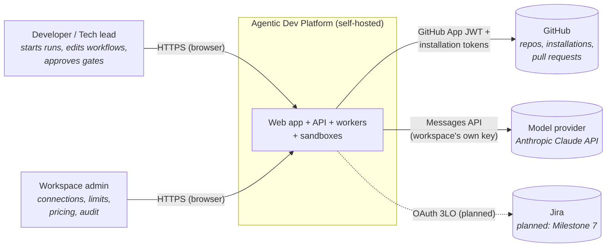
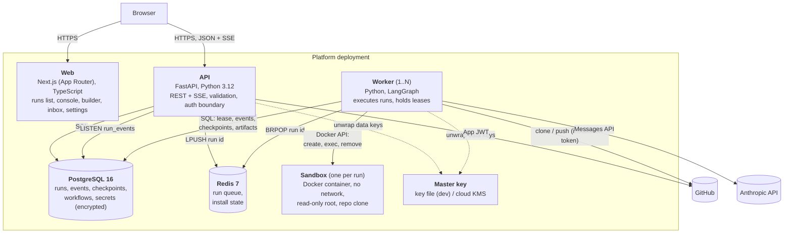
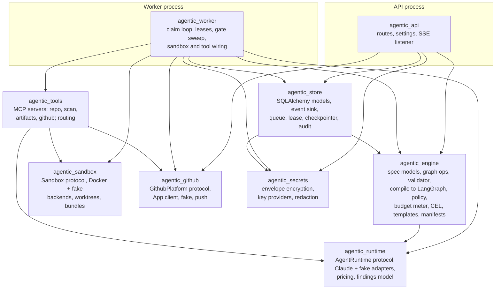
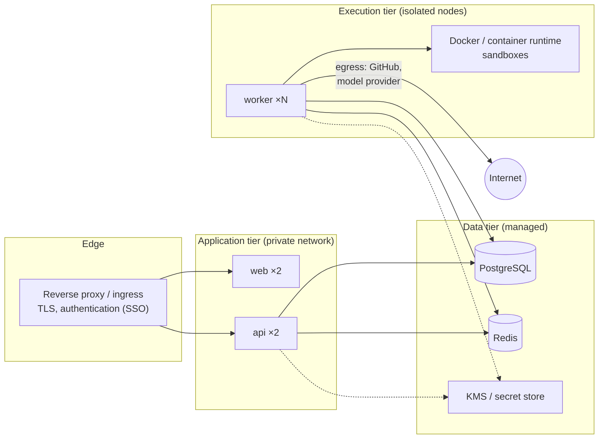

# Architecture overview

This document describes how the Agentic Dev Platform is built: the system context, the containers it runs as, the components inside them, and the qualities the design protects. Diagrams use the [C4 model](https://c4model.com/) levels and are written in Mermaid, so they render on GitHub and stay in version control next to the code.

Related documents:

- [Business flows](business-flows.md): what users do and in which order.
- [Technical flows](technical-flows.md): what the system does for each of those steps.
- [Data model](data-model.md): the tables and the invariants they hold.
- [Architecture decisions](decisions.md): why it is built this way.
- [Security model](../security/security-model.md) and [Deployment guide](../operations/deployment.md).

> **Source of truth.** [`specs/tech-stack.md`](../../specs/tech-stack.md) holds the binding API contracts and the full decisions log, and [`specs/roadmap.md`](../../specs/roadmap.md) says what is built. This document explains them; if it ever disagrees with `specs/`, `specs/` wins.

---

## 1. What the system does

The platform runs **AI agent workflows on a code repository**. A workflow is a graph built from a small set of primitives (`agent`, `tool`, `sequence`, `parallel`, `map`, `reduce`, `router`, `loop`, `gate`, and later `orchestrator` and `subflow`). The platform:

1. stores the workflow as a **versioned spec** (JSON, validated by Pydantic and exported as JSON Schema);
2. compiles it to a **LangGraph** graph and executes it on a **worker**, with durable checkpoints in Postgres;
3. gives agents **tools** (MCP servers owned by the platform) that act on a **sandboxed clone** of the repo;
4. pauses at **gates** for a human decision before any irreversible action (push, pull request, repo creation);
5. delivers code changes as a **branch and pull request** through a **GitHub App**;
6. records every step in an **append-only event log** that drives the live console, cost accounting and audit.

Three outcomes ship as templates today: **Generate docs**, **Audit codebase** and **New repo**. Spec-driven development from Jira, the Flow Architect agent and dynamic orchestration are on the [roadmap](../../specs/roadmap.md).

---

## 2. System context (C4 level 1)

| External system | What the platform uses it for | Credential | Who owns the credential |
|---|---|---|---|
| GitHub | List repos, clone private repos, push agent branches, open PRs, create org repos | GitHub App private key → short-lived installation tokens | The operator who registers the App |
| Anthropic | Run `agent` nodes | Workspace API key, stored encrypted | Each workspace ("bring your own key") |
| Jira *(planned)* | Trigger runs from issues, comment, transition | Atlassian OAuth 3LO | Each workspace |
| GitHub Copilot *(planned, Milestone 8)* | Second agent provider | GitHub OAuth / App | Each workspace |

No personal access token is ever stored.

---

## 3. Containers (C4 level 2)

| Container | Technology | Responsibility | Scales by |
|---|---|---|---|
| **Web** | Next.js, React, Tailwind v4, shadcn/ui | All user screens. Talks to the API from the browser; holds no secrets and no server-side state. | Stateless replicas |
| **API** | FastAPI, Pydantic v2, SQLAlchemy 2 (async), Alembic | REST endpoints, Server-Sent Events for live runs, workflow validation, graph operations, connections and secrets, GitHub install flow. Never runs agents. | Stateless replicas |
| **Worker** | Python, LangGraph, Anthropic SDK, MCP SDK, docker-py | Claims queued runs, compiles specs, runs agents and tools, writes events and checkpoints, enforces policy, pushes branches and opens PRs. | Add processes; runs are distributed by lease |
| **Sandbox** | Alpine + git + pinned scanners (ruff, Biome, ShellCheck, gitleaks, osv-scanner) | Holds the repo clone and writer worktrees; executes `repo.*` and `scan.*` tool commands. Has **no network and no credentials**. | One per run |
| **PostgreSQL** | PostgreSQL 16 | System of record: runs, append-only events, LangGraph checkpoints, artifacts, workflows and versions, approvals, audit, encrypted connections. `LISTEN/NOTIFY` fans out live events. | Managed service, vertical + read replicas |
| **Redis** | Redis 7 | Announces new runs (a list of run ids) and keeps single-use GitHub install `state` tokens (10 min TTL). Not a system of record: ownership and state are in Postgres. | Managed service |
| **Master key** | 32-byte key file (dev); cloud KMS (planned, phase 10.5) | Wraps each workspace's data key (envelope encryption). | — |

### Why the API and the worker are separate processes

The API answers in milliseconds; a run lasts minutes to hours and may wait days at a gate. Splitting them means a deploy or a crash of the API never interrupts a run, workers scale with load independently, and only workers need the Docker socket and outbound access to model providers. Postgres decides who runs what (leases); Redis only announces work. See [ADR-004](decisions.md#adr-004-postgres-leases-decide-ownership-redis-only-announces-work).

---

## 4. Components (C4 level 3)

The backend is a `uv` workspace of nine Python packages with one-way dependencies. The engine never imports the database; the runtime never imports the engine.

| Package | Key modules | Responsibility |
|---|---|---|
| `agentic_engine` | `spec/models.py`, `spec/ops.py`, `spec/validate.py`, `graph/compile.py`, `policy.py`, `budget.py`, `expr.py`, `nodes.py`, `templates/` | The workflow language: the spec schema, graph operations, the single validator, compilation of each primitive to LangGraph nodes, policy limits and budget metering, CEL expressions, node manifests (the palette), and built-in templates. Database-free: it talks to storage through protocols (`ArtifactStore`, event sink, checkpointer). |
| `agentic_runtime` | `protocol.py`, `claude.py`, `fake.py`, `pricing.py`, `contract.py` | One `AgentRuntime` interface: start an agent, receive an async stream of `AgentEvent`s, cancel cooperatively. The Claude adapter runs its own tool loop on the Messages API. The fake runtime makes every engine test deterministic and offline. `contract.py` checks the event-stream rules every adapter must follow. |
| `agentic_tools` | `repo/`, `scan/`, `artifacts/`, `github/`, `mcp_bridge.py`, `routing.py`, `strict.py` | Platform tools as MCP servers, connected in memory. `repo.*` reads (and, for writer nodes, writes and commits) in the sandbox; `scan.*` runs deterministic scanners; `artifacts.*` reads run artifacts; `github.*` opens PRs and creates repos. `strict_tool` refuses unknown arguments. |
| `agentic_sandbox` | `protocol.py`, `docker_backend.py`, `worktree.py`, `bundle.py` | One isolated workspace per run. Writers each get a git worktree on `agent/<run>/<node>`. Commits leave the sandbox only as a git bundle. |
| `agentic_github` | `platform.py`, `app.py`, `push.py`, `fake.py` | The `GithubPlatform` protocol (install URL, installations, repos, installation tokens, PRs, org repos), its githubkit implementation and an offline fake. `push.py` pushes a bundle from the worker with the token in the environment only. |
| `agentic_store` | `models.py`, `sink.py`, `queue.py`, `lease.py`, `checkpoint.py`, `expiry.py`, `audit.py` | Persistence. The event sink appends events and updates the run's summary columns in the same transaction, then `NOTIFY`s. |
| `agentic_secrets` | `envelope.py`, `keys.py`, `redact.py` | AES-256-GCM envelope encryption with per-row associated data; a `KeyProvider` protocol for the master key; redaction of live secrets from logs and events. |
| `agentic_api` | `runs/`, `workflows/`, `workspaces/`, `github/`, `templates/`, `node_types/` | HTTP surface. Its OpenAPI document generates the TypeScript client (`web/src/api`); CI fails if either is stale. |
| `agentic_worker` | `main.py`, `review.py`, `artifacts.py` | The run loop: claim, open sandbox, wire tools, execute, release; gate sweeps; cancellation. |

### Frontend structure

`web/` is a Next.js App Router application. Feature folders (`src/runs`, `src/workflows`, `src/inbox`, `src/settings`) sit on shared building blocks: `src/components/ui` (shadcn/ui primitives, owned in-repo), `src/components/display` (the only way to render times, durations, money, tokens, ids and paths), `src/components/states` (loading, empty and error states), and a generated API client. The canvas is a plain-HTML card tree (`SpecTree`) shared by the run map and the builder: no graph-layout engine. Server state goes through TanStack Query, live runs through `EventSource`. Look and feel are governed by [`specs/design-language.md`](../../specs/design-language.md) and enforced by lint rules and Playwright/axe checks.

---

## 5. Contracts between parts

| Contract | Defined in | Consumed by | Drift protection |
|---|---|---|---|
| Workflow spec | `agentic_engine.spec.models` → [`schemas/workflow-spec.v0.json`](../../schemas/workflow-spec.v0.json) | API, worker, web builder, (future) Flow Architect | CI regenerates the schema and fails if the committed file differs |
| Graph operations | `agentic_engine.spec.ops` → [`schemas/graph-ops.v1.json`](../../schemas/graph-ops.v1.json) | Builder canvas, (future) Architect | Same; the browser mirror of `apply_ops` is tested against shared fixtures |
| Findings report | `agentic_runtime.findings` → [`schemas/findings.v1.json`](../../schemas/findings.v1.json) | Scanners, `reduce` dedupe/vote, audit template | Additive-only evolution |
| HTTP API | FastAPI OpenAPI | `web/src/api` (generated) | CI job "API contract" fails on a stale client |
| Agent event stream | `agentic_runtime.protocol` + `contract.check_events` | Engine, every adapter | Contract tests run against each adapter |
| Node manifests | `agentic_engine.nodes`, served by `GET /node-types` | Palette and side panel | A test enforces one manifest per primitive |

---

## 6. Deployment view

The execution tier is the high-risk zone: it runs untrusted repository content next to model output. Keep workers on dedicated nodes, give them the only route to the container runtime, and allow them egress to GitHub and the model provider only. The [deployment guide](../operations/deployment.md) gives the full reference topology, sizing and a production checklist.

---

## 7. Quality attributes and how the design meets them

| Quality | Target | Mechanism |
|---|---|---|
| **Durability** | A worker restart mid-run loses no completed node (AC-8) | LangGraph Postgres checkpointer per node; run leases with a heartbeat; an expired lease lets another worker resume from the last checkpoint; `MAX_ATTEMPTS` stops crash loops |
| **Auditability** | Every agent action, tool call, artifact, approval and cost is recorded | Append-only `run_events`, `run_artifacts`, `workflow_versions` and `audit_events` (the last two guarded by database triggers that refuse `UPDATE`/`DELETE`) |
| **Safety** | No irreversible action without a human; limits enforced by the engine, not the graph | `gate` before push, PR, repo creation; policy ceilings checked at validation and at runtime; optional hard budget |
| **Isolation** | Repo content and agent output cannot reach the host, the network or credentials | Sandbox with no network, read-only root, `cap_drop: ALL`, `no-new-privileges`, non-root user, CPU/memory/PID limits; credentials only on the worker |
| **Confidentiality** | Model keys never appear in logs, events or agent context | Envelope encryption (AES-256-GCM, per-workspace data key, row-bound AAD); redaction filter on every log handler; keys used only by the run's own client |
| **Live feedback** | Events visible in the console within 1 s | Postgres `NOTIFY` → API listener → SSE; deltas buffered 250 ms server-side and merged client-side |
| **Truthful numbers** | Durations are active time; costs never rewritten | Active and waiting time kept apart on the run row; cost priced once when the usage event is logged |
| **Extensibility** | A new primitive, provider or tool needs no change elsewhere | Manifests drive the palette and forms; `AgentRuntime`, `GithubPlatform`, `Sandbox` and `KeyProvider` are protocols; tools are MCP servers. See [Connecting your platforms](../integrations/connecting-platforms.md) |
| **Provider neutrality** | The same workflow runs on Claude or Copilot | Tools live in the platform, not the provider; usage normalised into one event |
| **Accessibility** | WCAG 2.2 AA; usable at 375–1440 px | Design tokens, shared components, axe and layout screenshots in CI |

---

## 8. Current limitations

Read these before deploying. They are tracked in the roadmap and in [`TODO.md`](../../TODO.md).

- **No user authentication or authorisation in the API yet.** Anyone who can reach the API can act on every workspace. Deploy it only behind an authenticating proxy on a private network. See [Security model → Known gaps](../security/security-model.md#7-known-gaps-and-hardening-roadmap).
- **Single default workspace in the UI.** The data model is multi-tenant; membership and roles are not built.
- **Worker uses the host Docker socket** in the reference compose setup. Production isolation (gVisor or Firecracker) is phase 10.2.
- **One model provider** (Claude). Copilot is Milestone 8.
- **GitHub only.** GitLab, Bitbucket and Azure DevOps would be new `GithubPlatform`-style adapters.
- **No OpenTelemetry tracing yet** (phase 10.3); logs are structured and redacted.
