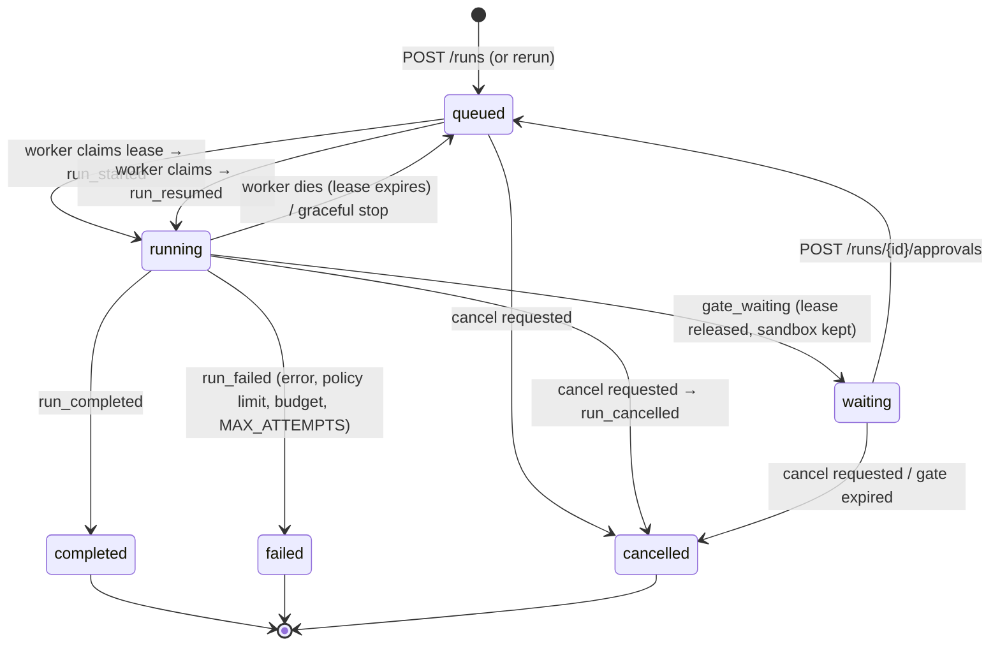
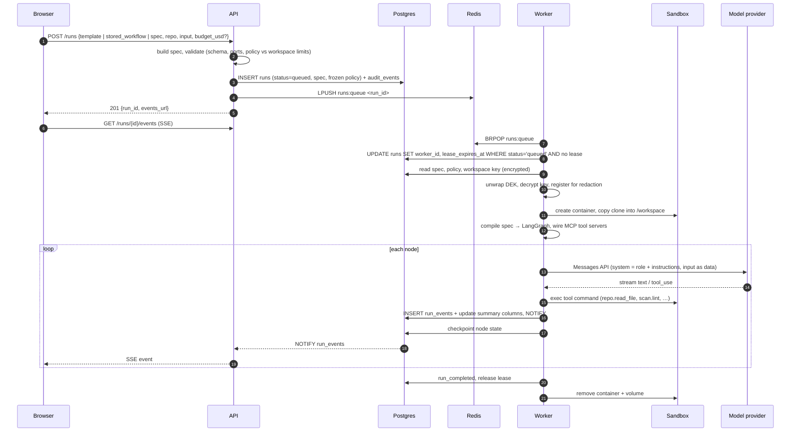
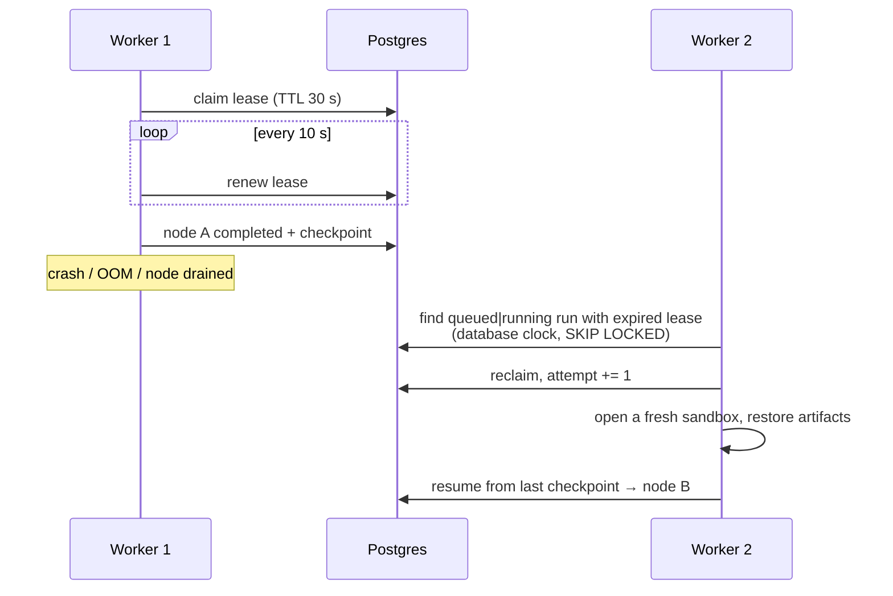
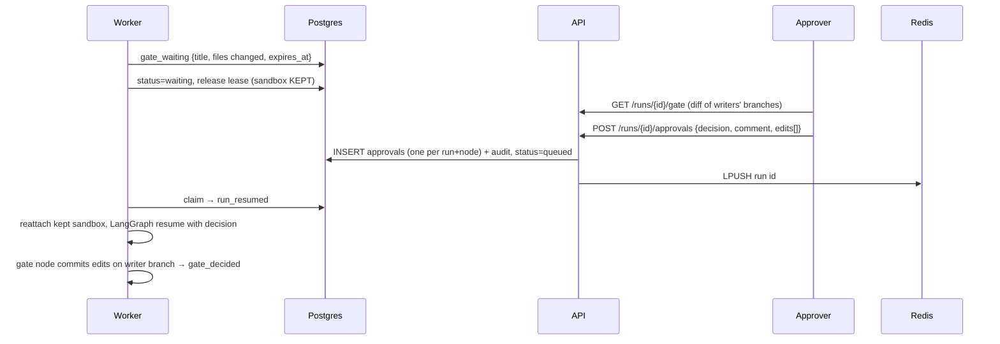
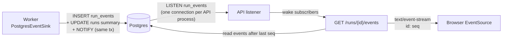
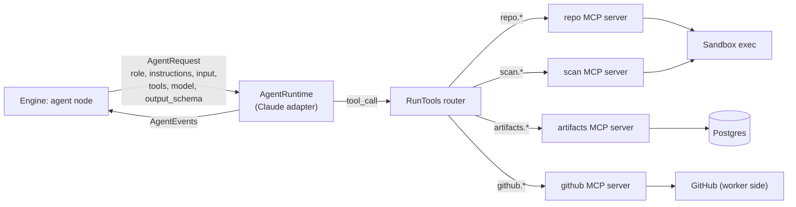
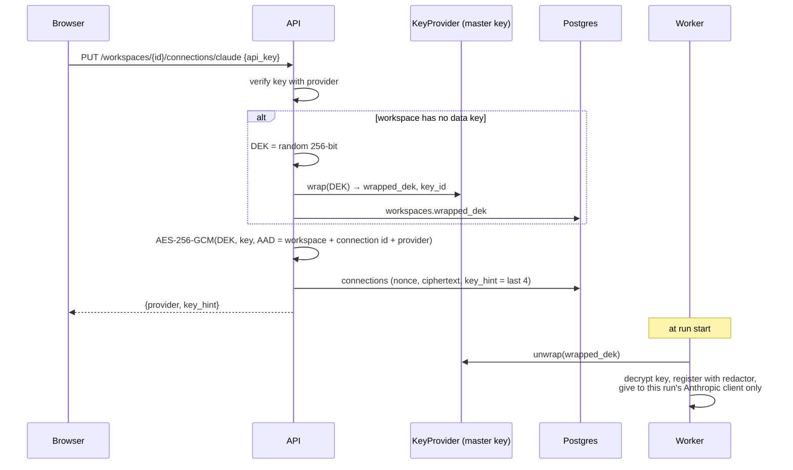
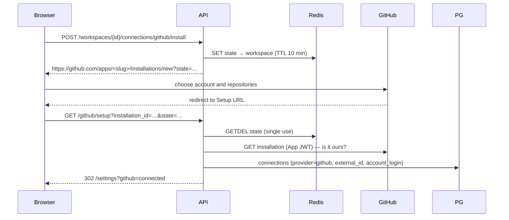

# Technical flows

How the system carries out each [business flow](business-flows.md): the requests, the processes involved, what is written where, and what happens on failure. Read the [architecture overview](overview.md) first for the containers and packages named here.

---

## 1. Run lifecycle

A run's `status` lives on its `runs` row. It is a **projection** of the run's append-only events, written by the event sink in the same transaction as each event.



Six statuses only. "Expired" is a cancelled run whose `run_cancelled` event carries `{reason: "Approval expired", expired: true}`, so no filter or badge needs a seventh status.

---

## 2. Starting and executing a run



Key points:

- **Only the run id travels through Redis.** The spec, input and limits are read from Postgres, so a lost Redis message cannot change what runs, and a run is never executed twice: the conditional `UPDATE` that claims a lease succeeds for exactly one worker.
- **The policy is frozen at creation** (`runs.policy`). Resumes and later policy changes never move the limits a run was given.
- **Validation runs twice**: before the run (`422` on a violation) and inside the engine while it runs (agents spawned and alive, wall time, budget).
- Text deltas are buffered for 250 ms before they are written, so the log holds messages rather than thousands of tokens; the browser merges deltas into one growing message per agent turn.

---

## 3. Durable execution and recovery



- **What is durable:** every completed node's state (LangGraph Postgres checkpointer), every event, every artifact version. A node that was mid-flight runs again from its start.
- **Expiry uses the database clock**, so worker clock skew cannot cause two owners.
- **Crash loops stop:** a run claimed more than `MAX_ATTEMPTS` times (default 3) fails with a reason.
- **Graceful stop:** a stopping worker cancels its graph without ending the run and releases the lease, so another worker resumes it at once.
- **Spend survives restarts:** the budget meter starts from the run's stored spend, so earlier attempts and time before a gate count.

---

## 4. Gates: pause, review, resume



- The gate is a LangGraph `interrupt()`. No worker holds a waiting run, so a gate can wait for days at no compute cost.
- **Expiry:** every worker sweeps every `GATE_SWEEP_S` (30 s) for runs whose `gate_expires_at` has passed, marks them cancelled with the reason, and queues them so a worker ends them and removes the sandbox. Expiry is a write, not something computed when the run is read, so a run nobody opens still expires.
- Edits are committed by the gate node itself, so they are checkpointed with the decision and the next node (`github.openPR`) needs no special case.

---

## 5. Delivering a change: from sandbox to pull request

The sandbox has **no network and no credentials**, so commits leave it as data and are pushed by the worker.

```mermaid
sequenceDiagram
    participant Ag as Writer agent
    participant S as Sandbox (no network)
    participant W as Worker
    participant GH as GitHub

    Ag->>S: repo.write_file / repo.commit (worktree agent/<run>/<node>)
    Note over S: commit as sandbox user on own branch
    W->>S: git bundle <base>..<branch>
    S-->>W: bundle bytes
    W->>GH: mint installation token (App JWT, short-lived)
    W->>W: throwaway repo: depth-1 fetch base, fetch bundle,<br/>check branch descends from base
    W->>GH: git push (create branch only; token as HTTP header via env)
    W->>GH: POST pulls (head=agent/<run>/<node>, base=ref)
    W->>W: pr_opened {url}
```

Safety properties of the push:

- The token reaches git only through `GIT_CONFIG_*` environment variables as an HTTP header: never argv, a remote URL or a config file. git reads no system or user config, runs no hooks and never prompts.
- The push may only **create** the branch (or find it already at the same commit, for a retried node). It cannot force-push or touch another branch.
- Error messages carry git's reason, never the token.

**New repositories** (`github.createRepo`): the gated node creates an organisation repo with GitHub's `auto_init`, the attempt ends `suspended`, and the worker immediately starts a new attempt that clones the new repo through the normal path.

---

## 6. Live event streaming



- Each event has a per-run `seq` (unique with the run id), which is the SSE `id`. A reconnecting browser sends `Last-Event-ID` and receives exactly the events after it, read from Postgres. Notifications only say "something changed", so a dropped notification costs latency, never data.
- `GET /runs/stream` and `GET /runs/counts` keep the runs list and sidebar counts live the same way.
- Event types include `run_started`, `node_started`, `text_delta`, `reasoning_delta`, `tool_call`, `tool_result`, `usage`, `map_item_*`, `parallel_branch_*`, `loop_*`, `artifact_written`, `gate_waiting`, `gate_decided`, `pr_opened`, `repo_created`, `policy_limit_exceeded`, `node_completed|failed|cancelled`, `run_completed|failed|cancelled|resumed`.

---

## 7. Agent execution and tools



- **Prompt-injection defence by structure.** Role and instructions are the system prompt. Repo content, previous outputs and tool results reach the model only as input marked as data (an `<input>` block, `tool_result` blocks), never as instructions.
- **Tools are granted per node.** An agent sees only the tools its spec names; audit agents get read tools only. Writer nodes (those that name `repo.write_file` or `repo.commit`) each get their own worktree; readers see a root-owned, read-only checkout.
- **Strict arguments.** `strict_tool` refuses unknown arguments. Every tool takes an optional `description` (why the call is made), shown in the console.
- **Typed ports.** If a node declares `output_schema`, the engine asks for JSON, parses it and validates it with `jsonschema` (2020-12, local `$ref`s only, so validating never fetches a URL). A wrong shape fails at that edge with a JSON pointer.
- **Artifacts.** Nodes declare `writes` and `reads`; every version is stored in `run_artifacts` and copied read-only into the sandbox. There is no write tool, so the validator sees every writer before the run.

---

## 8. Workflow editing: graph operations and versions

```mermaid
sequenceDiagram
    participant C as Canvas (browser)
    participant A as API
    participant E as Engine
    participant PG as Postgres

    C->>C: edits kept as ops; browser mirror of apply_ops draws them
    C->>A: POST /workflows/{id}/validate (debounced)
    A->>E: validate(spec) → issues[]
    A-->>C: 200 {issues} (shown on nodes)
    C->>A: PATCH /workflows/{id} {base_version, ops[]}
    A->>PG: SELECT workflow FOR UPDATE (row lock)
    alt base_version ≠ latest
        A-->>C: 409 (re-apply ops on latest)
    else
        A->>E: apply_ops → new spec; schema check
        A->>PG: INSERT workflow_versions (spec, ops, base_version)
        A-->>C: 200 {version}
    end
```

- Operations: `addNode`, `removeNode`, `connect`, `disconnect`, `setParam` (with `wrap` and `extract` planned). They address nodes by id over the spec's tree, so ids stay stable as the tree changes (unlike JSON Patch array positions).
- Versions are append-only (a database trigger refuses `UPDATE`/`DELETE`). A restore copies an old spec as the next version with `restored_from`.
- A version must match the schema but may hold other issues (work in progress); **runs** refuse any version with issues.

---

## 9. Secrets: storing and using a model key



- The associated data binds a ciphertext to its row, so a ciphertext copied to another workspace or provider fails to decrypt.
- The master key never leaves its `KeyProvider`; swapping the local key file for a cloud KMS is a new provider class, not a schema change.
- Redaction is a second line of defence: any registered value is replaced with `[REDACTED]` in log records and event payloads while it is held.

---

## 10. GitHub App installation



A GitHub connection holds **no secret**: only the installation id. Tokens are minted on demand from the App's private key and expire within an hour. Hardening still to do (users and OAuth during install, narrower token scopes) is listed in the [security model](../security/security-model.md#7-known-gaps-and-hardening-roadmap).

---

## 11. Cost accounting and limits

1. The adapter emits one `usage` event per provider call, with input, output and cache tokens.
2. It prices that call from the workspace's price table (list prices dated by `PRICES_AS_OF`, plus overrides) and writes `estimated_usd` into the event. **The logged price never changes.**
3. The event sink adds the totals to the `runs` row; a usage with no price marks the run's cost incomplete.
4. The engine's budget meter adds each priced usage. When spend reaches the budget, running nodes are cancelled and the run fails with `policy_limit_exceeded {limit: "budget_usd"}`.
5. Wall time counts active time only: the worker compares the run's active seconds (stored stretches plus this attempt) with `wall_time_s`.
