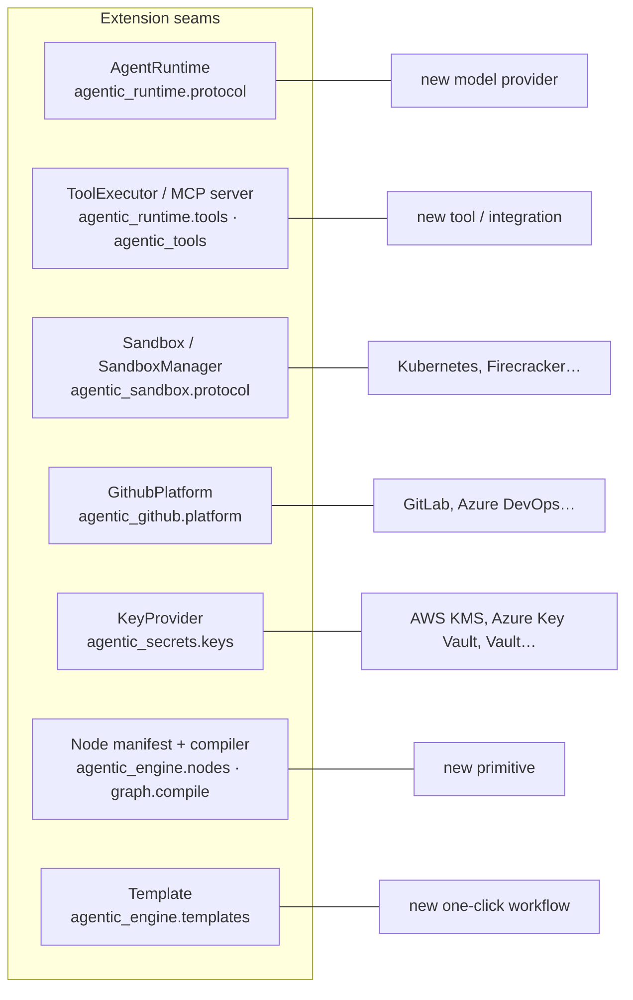

# Connecting your platforms

The platform holds no credentials of its own. Every deployment connects **its own** GitHub App and **its own** model provider keys, and every integration point is an interface you can implement. This guide covers both:

- **Part 1, connect:** register your GitHub App, add your model keys, set your prices, call the API from your systems.
- **Part 2, extend:** add a model provider, a tool, a sandbox backend, a Git host, a key-management service, a primitive or a template.

---

## Part 1: Connect

### 1. GitHub: register your own GitHub App

Each deployment registers its own App. It never shares one with another deployment, and no personal token is used.

1. Go to **GitHub → Settings → Developer settings → GitHub Apps → New GitHub App**, under your **organisation** if you want "New repo" to work (installation tokens cannot create personal repositories).
2. Fill in:

   | Field | Value |
   |---|---|
   | GitHub App name | Anything; its URL slug becomes `GITHUB_APP_SLUG` |
   | Homepage URL | Your web app, e.g. `https://app.example.com` |
   | Setup URL | `https://api.example.com/github/setup` (the **API**), with **Redirect on update** ticked |
   | Request user authorization (OAuth) during installation | Off (not used yet) |
   | Webhook | **Active** ticked, URL `https://api.example.com/github/webhooks` (the **API**), and a **Webhook secret** you generate (the same value as `GITHUB_WEBHOOK_SECRET`). Leave it unticked if you do not want review follow-ups (7.6). |
   | Where can this App be installed? | Only on this account |

3. **Repository permissions.** Grant only what the workflows you run need:

   | Permission | Access | Needed for |
   |---|---|---|
   | Metadata | Read | Listing repositories (always) |
   | Contents | Read | Cloning private repositories |
   | Contents | Read and write | Pushing agent branches (`github.openPR`) |
   | Pull requests | Read and write | Opening pull requests, reading review comments and reacting to them, pushing review follow-ups (7.6) |
   | Issues | Read and write | Reading a pull request's conversation comments and posting the follow-up's reply (7.6) |
   | Administration | Read and write | Creating repositories (`github.createRepo`, "New repo"). Leave off if you don't need it. |

   With the webhook on, **subscribe to events** `Issue comment`, `Pull request review` and `Pull request review comment` (7.6). Nothing else is needed: every other event is ignored.
4. Create the App, note its **App ID**, and **Generate a private key**.
5. Give the key to the API and the worker as a read-only file, and set the variables (see [configuration](../operations/configuration.md)):
   ```dotenv
   GITHUB_APP_ID=123456
   GITHUB_APP_SLUG=acme-agentic-dev
   GITHUB_APP_PRIVATE_KEY_FILE=/run/secrets/github-app.pem   # compose: .secrets/github-app.pem
   GITHUB_WEBHOOK_SECRET=…   # the App's webhook secret, on the API only; unset, /github/webhooks answers 503
   ```
6. In the web app, open **Settings → Integrations → Install GitHub App**, choose the account and **only the repositories** agents should work on. GitHub sends you back to Settings, which lists them.

Recommended on the GitHub side: protect default branches (required reviews, required checks), and treat PRs from the App's bot like any external contribution.

### 2. Model provider: your own Claude key

1. Set `AGENTIC_RUNTIME=claude` on the workers (and a master key on API and workers).
2. In **Settings → Integrations**, paste an Anthropic API key. It is verified with one call, encrypted with the workspace's data key, and from then on shown only as its last four characters.
3. Choose models per agent node in the builder's side panel, or rely on the default (`CLAUDE_MODEL`). The audit template has its own `reviewer_model` and `report_model` options.

Each workspace pays its provider directly. Use a key from a dedicated Anthropic workspace with its own spend limit, so the provider's limit backs up the platform's budget.

GitHub Copilot as a second provider is roadmap Milestone 8; the start screen already shows it as "not available yet".

### 3. Prices and limits

- **Settings → Models and pricing:** list prices (dated) are built in; override them with your negotiated rates. Cost is priced when each call is logged and never recomputed.
- **Settings → Limits and budgets:** lower any platform ceiling and set a default budget for the workspace's runs.

### 4. Jira: register your own Atlassian OAuth app

Each deployment uses its own Atlassian OAuth 2.0 (3LO) app; a workspace then connects one Atlassian account and picks the Jira projects its runs may use. Jira Cloud only.

1. In the [Atlassian developer console](https://developer.atlassian.com/console/myapps/), create an **OAuth 2.0 integration**.
2. **Permissions:** add the Jira API with the scopes `read:jira-work`, `write:jira-work`, `manage:jira-webhook` and `read:jira-user`, and the User identity API with `read:me`. The platform also asks for `offline_access`, which needs no setup.
3. **Authorization:** set the callback URL to `<your API's public URL>/jira/callback` (`API_BASE_URL` + `/jira/callback`).
4. **Settings:** copy the client id into `ATLASSIAN_CLIENT_ID` and save the secret in a file the API can read, named by `ATLASSIAN_CLIENT_SECRET_FILE` (with compose: `.secrets/atlassian-client-secret`). The API and the worker both need them: the worker renews the grant when a run's Jira tools call Atlassian. Set `WEB_BASE_URL` on the worker too, so the comments runs post link back to the run.
5. In the web app, open **Settings → Integrations → Jira → Connect Jira**, consent on Atlassian, then use **Choose projects** on each site. Nothing on a site is usable until projects are picked; a site can be turned off without losing its list.

What to know:

- **Jira acts as the account that consented.** Comments and transitions a run makes (from the Jira tools, always after an approval) carry that person's name. Connect with a dedicated Jira account that has access to the projects you want, not with a personal one.
- **Consent is per site, project scoping is the platform's.** Atlassian cannot limit a grant to some projects, so the platform keeps the list you pick and checks it on every call.
- **Tokens** are stored encrypted with the workspace's data key and renewed automatically. If Atlassian refuses to renew them (the access was removed, or unused for 90 days), the card shows **Needs attention** with **Reconnect**; the picked projects are kept.
- **Disconnect** forgets the tokens and the picked projects. To remove the app's access as well, open the Atlassian account's [connected apps](https://id.atlassian.com/manage-profile/apps).
- To try the screens without Atlassian, set `AGENTIC_JIRA=fake` (refused with `AGENTIC_ENV=production`).

**What runs can do in Jira (7.2).** Agents may be given `jira.getIssue`, `jira.search` and `jira.listTransitions`: they read issues, their comments and the transitions their workflow offers, only in the projects you picked. A workflow writes to Jira only from a step after an approval gate: `jira.comment` posts a comment (ending with a line that links the run) and `jira.transition` moves an issue. The **Answer a Jira issue** template is the simplest example: an agent reads the issue and the code, you approve its comment, and it is posted. Issue text is given to agents as data, never as instructions.

**Issues that start runs (7.3).** In **Settings → Triggers**, add a rule: when an issue of a picked project moves to a status, or gets a label, a run of a template or stored workflow starts on a repo, with the issue key as its input (the workflow must declare a required input). The run reads the issue itself with `jira.getIssue`; nothing from the issue's text is passed to it. Every write the run makes still waits for an approval.

- **Jira must reach the API.** The platform registers a webhook on each site your rules use, pointing at `<JIRA_WEBHOOK_BASE_URL or API_BASE_URL>/jira/webhooks`, and renews it before Jira's 30-day expiry. That URL must be public. In development, open a tunnel to the API (`ngrok http 8000`) and set `JIRA_WEBHOOK_BASE_URL` to the tunnel's URL on the API.
- **The connected account must own the Atlassian app.** Jira delivers an OAuth app's webhooks only when the account that registered them (the one that connected the workspace) owns the app, unless the app is shared. Create the app with the dedicated Jira account you connect, or share it with that account.
- **One address and five webhooks per account.** Jira lets one account register webhooks at a single URL, and at most five per site. A workspace uses one per site. An account that already sends webhooks elsewhere (another deployment, a script) shows "Not listening" with the reason on Settings → Triggers until those are removed.
- **Each move starts at most one run per rule.** A delivery Jira retries is recognised and dropped; while a rule's run on an issue is queued, running or waiting, moving the issue again starts no other; a move a run made itself (`jira.transition`) starts nothing.
- **Projects you did not pick are ignored**, whatever Jira sends.

**Issues built into pull requests (7.5).** The **Build from a Jira issue** template is spec-driven development in GitHub Spec Kit's stages. Start it from a trigger rule (for example: project API, status "Ready for dev", template "Build from a Jira issue", your repo), or by hand from the template gallery with an issue key. A run started by hand is told the issue too, on the site where you picked its project. A run:

1. writes a specification (`spec.md`) from the issue, its acceptance criteria (mapped in Settings, 7.4) and the code, marking each open question `[NEEDS CLARIFICATION: …]`;
2. waits for you to approve the specification. Rejecting it ends the run without building anything;
3. if the specification has open questions, shows you the comment that asks them and posts it on the issue once you approve;
4. writes a plan (`plan.md`) and a task list (`tasks.md`), then has a lead engineer split the tasks between engineers on agent branches, while a reviewer checks each requirement and sends the work back (at most `max_passes` times);
5. commits the specification, plan and tasks to `specs/<KEY>-<summary>/` on the same branch, so they are in the pull request (Spec Kit reads them from there);
6. waits for you to approve the diff, then pushes the branch, opens one pull request, comments on the issue with links to the pull request and to each file under `specs/` in it, and, when you set **Move to**, moves the issue to that status (for example "In Review").

The links in that comment are made by the platform from the pull request it opened, never written by an agent. Everything it posts appears as written by the connected Jira account.

**Spec files instead of Jira (7.7).** The **Build from a spec file** template does the same from a Markdown file, with no Jira connection (it needs Claude and GitHub). In its New run sheet, under **Which spec?**, choose:

- **Upload**: a `.md` or `.markdown` file from your computer, up to 256 KB; or
- **From the repo**: a path from the repository's root, such as `docs/spec.md`, read from the run's branch when the run starts.

The run keeps the file (a rerun uses the same one, even if the repo changed since) and every agent is told it as data, never as instructions. The spec writer rewrites it in Spec Kit's layout, keeping every requirement it states; its open questions (`[NEEDS CLARIFICATION: …]`) are for you to answer at the spec gate: approve to build with the assumptions it makes, or reject, change your file and start again. The specification, plan and tasks are committed to `specs/<your file's title>/` (its first `# ` heading as a slug, else the file's name), and after you approve the diff one pull request opens. Nothing is posted anywhere else.

**Review comments that start a follow-up (7.6).** On a pull request a **Build from a Jira issue** run opened, anyone with write access to the repo can write `@<your app's slug> fix this` (for example `@acme-agentic-dev fix this`) in a comment, a review or an inline comment. The platform:

1. reacts 👀 to the comment and starts a follow-up run, listed as "GitHub · PR #42 review" and linked as "Follow-up of <id>";
2. checks that nobody else pushed to the pull request since the run pushed, reads the review once (the comment that asked, and the comments, reviews and inline comments people with write access left since the last push; bots are left out) and gives it to every agent as data;
3. runs the review loop again on the pull request's code: the lead plans only what the review asks, and the reviewer checks each comment;
4. waits for you to approve the diff, then pushes the new commits to the same pull request (a fast-forward, never a force push), replies once "Pushed `<sha>` for @author's review, run <id>", and comments the links on the Jira issue again.

- **Only the command starts anything.** Other comments, bots and people without write access start nothing; a command while a run on the pull request is still going, past the workspace's **Follow-ups per pull request** (3 by default, at most 10, in Settings → Run limits) or on a closed pull request gets 😕. Every command is in the audit log with what came of it.
- **A person's commits are never overwritten.** If someone pushed to the pull request's branch after the run, the follow-up fails `pr_head_moved` before it does anything; rebase or merge by hand, then ask again.
- **GitHub must reach the API.** The webhook URL must be public. In development, open a tunnel to the API (`ngrok http 8000`) and set the App's webhook URL to `<tunnel>/github/webhooks`. GitHub's **Recent Deliveries** tab on the App shows each delivery and lets you redeliver one; a redelivery is recognised and starts nothing twice.
- Other templates do not follow up reviews yet. A stored workflow can, with `on_review: {"from": "<the step to start at>"}`: that step must come before its one `github.openPR`, with a gate between them.

### 5. Calling the platform from your systems

The API is described by OpenAPI at `/docs` (Swagger UI) and `/openapi.json`. Typical integrations are CI jobs, chat bots or internal portals that start runs and wait for the result.

```bash
# Start an audit on a repo
curl -s -X POST https://api.example.com/runs \
  -H 'Content-Type: application/json' \
  -d '{
        "template": {"id": "audit-codebase", "parameters": {}},
        "repo": {"url": "https://github.com/acme/payments", "ref": "main"},
        "trigger": "api"
      }'
# → {"run_id": "…", "status": "queued", "events_url": "…/runs/<id>/events"}

# Follow it live (Server-Sent Events; reconnect with Last-Event-ID)
curl -N https://api.example.com/runs/<id>/events

# Or poll its summary, and fetch its artifacts
curl -s https://api.example.com/runs/<id>
curl -s https://api.example.com/runs/<id>/artifacts/report.md
```

Check the exact request shapes in `/docs`: the snippets above show the flow, the OpenAPI document is the contract. Your proxy must authenticate these calls too (for example with a service account at the identity-aware proxy). Inbound webhooks are Jira's (`/jira/webhooks`, 7.3) and the GitHub App's (`/github/webhooks`, 7.6): they are signed by the sender, so your proxy must let them through unauthenticated.

---

## Part 2: Extend

Every integration point is a Python `Protocol` with a fake implementation used in tests. The fake is the best reference for the minimum an implementation must do. Follow the repo's process for any extension that should be merged: plan the change in `specs/`, record decisions in `specs/tech-stack.md`, add a changelog entry (see [CONTRIBUTING](../../CONTRIBUTING.md)).



### 6. Adding a model provider

Implement `AgentRuntime` ([`packages/runtime/src/agentic_runtime/protocol.py`](../../packages/runtime/src/agentic_runtime/protocol.py)):

```python
class AgentRuntime(Protocol):
    def start(self, request: AgentRequest) -> AgentRun: ...


class AgentRun(Protocol):
    def __aiter__(self) -> AsyncIterator[AgentEvent]: ...
    def cancel(self) -> None: ...
```

Rules every adapter must follow (checked by `agentic_runtime.contract.check_events`, so run your adapter through it in tests):

- The stream ends with exactly one terminal event, `completed`, `failed` or `cancelled`, and nothing follows it.
- Every `tool_result` follows a `tool_call` with the same `call_id`; call ids are unique.
- At least one `usage` event comes before `completed`, priced from the price table you receive (`agentic_runtime.pricing`).
- `cancel()` is idempotent and cooperative.
- Keep instructions and data apart: `role` and `instructions` are the system prompt; `input` and tool results are data.
- Execute tools through the `ToolExecutor` you are given. Never use the provider's built-in tools, or workflows stop behaving alike across providers.

Then wire it in: add the provider name to the worker's `AGENTIC_RUNTIME` choices and its factory in `agentic_worker.main.run_runtimes` (the Claude branch shows how a per-run client is built from the workspace's stored key, registered for redaction while held). Add the provider to the agent manifest's `provider` enum (`agentic_engine.nodes`) so the builder offers it, add its list prices to `agentic_runtime.pricing`, and add a connection type with key verification in `agentic_api.workspaces`. Reference: [`claude.py`](../../packages/runtime/src/agentic_runtime/claude.py) and [`fake.py`](../../packages/runtime/src/agentic_runtime/fake.py).

### 7. Adding a sandbox backend

Implement `Sandbox` and its manager ([`packages/sandbox/src/agentic_sandbox/protocol.py`](../../packages/sandbox/src/agentic_sandbox/protocol.py)): `open(run_id, source, reuse=…)`, `keep`, `discard`, and on the sandbox `exec`, `put_file`, `take_file`, `put_artifact`, `workdir`, `worktrees_dir`, `staging_dir`, `artifacts_dir`, and `run_job` with `job_networks` (a short-lived container on the same files with its own limits, network `none` or `nuget`; return no `nuget` network if the backend cannot route to the egress proxy). A Kubernetes backend would create one pod per run with a `RuntimeClass` (gVisor or Kata), no service account token, a `NetworkPolicy` denying all egress, and a volume holding the clone; `exec` maps to the pod exec API.

Keep the guarantees of the Docker backend ([`docker_backend.py`](../../packages/sandbox/src/agentic_sandbox/docker_backend.py)): no network, no credentials, non-root, read-only root, resource limits, a root-owned checkout, writer worktrees owned by the sandbox user, and a label with the run id so leftovers can be swept. Run the backend through the sandbox test suite.

### 8. Adding a tool or integration

Tools are MCP servers built with the official Python SDK and connected in memory.

1. Write the server in `packages/tools/src/agentic_tools/<name>/`. Wrap every tool with `strict_tool` (refuses unknown arguments, adds the optional `description`). Return structured content when the output has a schema. Keep credentials inside the server; never return them.
2. Expose it as a `ToolExecutor` with `McpToolExecutor` and a prefix: tools are offered as `<prefix>.<tool>`.
3. Open it per run in the worker and add it to the run's `RunTools` (see where `open_scan_tools` and `open_github_tools` are wired in `agentic_worker.main`). Two executors may not offer the same name.
4. Register the tool names in `agentic_engine.spec.models` (`PLATFORM_TOOLS`, and the prefix in `REPO_TOOL_PREFIXES` if it needs the sandbox), so the validator accepts them and the side panel offers them.
5. If the tool has effects outside the sandbox, the workflow must put a `gate` before it. Follow `github.openPR` as the model.

Integrations that need code or network of their own (an internal API, a proprietary linter) are what **plugin nodes** (roadmap 10.1) are for: a manifest plus a container or HTTP endpoint with its own sandbox.

### 9. Adding a Git host (GitLab, Azure DevOps, Bitbucket)

Today the platform is GitHub-only, by design for v1. The seam is `GithubPlatform` ([`platform.py`](../../packages/github/src/agentic_github/platform.py)): install URL, installations, repos, installation tokens, repo creation and pull requests. Supporting another host means:

- a platform client implementing the equivalent operations (for GitLab: a group access token or OAuth application instead of App installations);
- the push path in [`push.py`](../../packages/github/src/agentic_github/push.py), which validates `https://github.com/<owner>/<repo>` URLs and sends the token as an HTTP header;
- a connection type and setup flow in `agentic_api`, and a tool server for its PR/MR operations.

This is a substantial change: plan it as a roadmap phase.

### 10. Using your own key-management service

Implement `KeyProvider` ([`keys.py`](../../packages/secrets/src/agentic_secrets/keys.py)):

```python
class KeyProvider(Protocol):
    def key_id(self) -> str: ...
    def wrap(self, dek: bytes, context: bytes) -> WrappedKey: ...
    def unwrap(self, wrapped: WrappedKey, context: bytes) -> bytes: ...
```

Map `wrap`/`unwrap` to your KMS's encrypt/decrypt (AWS KMS, Azure Key Vault, Google Cloud KMS, HashiCorp Vault Transit), passing `context` as the encryption context or associated data. Only wrapped data keys are stored, so moving providers means re-wrapping each workspace's `wrapped_dek`; secrets themselves need no re-encryption.

### 11. Adding a primitive

A primitive needs: a Pydantic model in `agentic_engine.spec.models` (it then appears in the exported JSON Schema; regenerate with `scripts/export_workflow_schema.py`), validation rules in `spec/validate.py`, compilation to LangGraph in `graph/compile.py`, and a manifest in `agentic_engine.nodes.NODE_MANIFESTS` (a test enforces one per primitive). The palette, the side panel and the canvas pick it up from `GET /node-types` with no web change. Prefer composing existing primitives: most new behaviour is a template or (soon) a composite node, not a primitive.

### 12. Adding a template

A template is a typed parameter model plus a function that builds a `WorkflowSpec`. Add it to `TEMPLATES` in [`agentic_engine/templates/__init__.py`](../../packages/engine/src/agentic_engine/templates/__init__.py), with the connections it `requires`. The start screen renders its options from the parameter schema. Use [`docs.py`](../../packages/engine/src/agentic_engine/templates/docs.py) and [`audit.py`](../../packages/engine/src/agentic_engine/templates/audit.py) as models: put a gate before every write, keep user text out of instructions except in its own block, and stay within the platform's policy ceilings.
