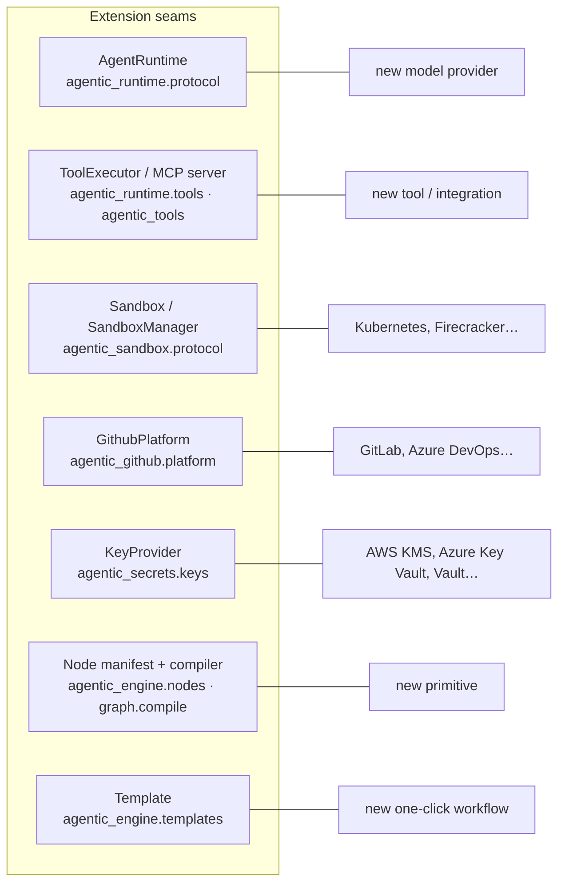

# Connecting your platforms

The platform holds no credentials of its own. Every deployment connects **its own** GitHub App and **its own** model provider keys, and every integration point is an interface you can implement. This guide covers both:

- **Part 1, connect:** register your GitHub App, add your model keys, set your prices, call the API from your systems.
- **Part 2, extend:** add a model provider, a tool, a sandbox backend, a Git host, a key-management service, a primitive or a template.

---

## Part 1: Connect

### 1. GitHub: register your own GitHub App

Each deployment registers its own App. It never shares one with another deployment, and no personal token is used.

1. Go to **GitHub → Settings → Developer settings → GitHub Apps → New GitHub App**, under your **organisation** if you want "New repo" to work (installation tokens cannot create personal repositories).
2. Fill in:

   | Field | Value |
   |---|---|
   | GitHub App name | Anything; its URL slug becomes `GITHUB_APP_SLUG` |
   | Homepage URL | Your web app, e.g. `https://app.example.com` |
   | Setup URL | `https://api.example.com/github/setup` (the **API**), with **Redirect on update** ticked |
   | Request user authorization (OAuth) during installation | Off (not used yet) |
   | Webhook | **Active unticked** (webhooks arrive with roadmap phase 7.6) |
   | Where can this App be installed? | Only on this account |

3. **Repository permissions.** Grant only what the workflows you run need:

   | Permission | Access | Needed for |
   |---|---|---|
   | Metadata | Read | Listing repositories (always) |
   | Contents | Read | Cloning private repositories |
   | Contents | Read and write | Pushing agent branches (`github.openPR`) |
   | Pull requests | Read and write | Opening pull requests |
   | Administration | Read and write | Creating repositories (`github.createRepo`, "New repo"). Leave off if you don't need it. |

4. Create the App, note its **App ID**, and **Generate a private key**.
5. Give the key to the API and the worker as a read-only file, and set the variables (see [configuration](../operations/configuration.md)):
   ```dotenv
   GITHUB_APP_ID=123456
   GITHUB_APP_SLUG=acme-agentic-dev
   GITHUB_APP_PRIVATE_KEY_FILE=/run/secrets/github-app.pem   # compose: .secrets/github-app.pem
   ```
6. In the web app, open **Settings → Integrations → Install GitHub App**, choose the account and **only the repositories** agents should work on. GitHub sends you back to Settings, which lists them.

Recommended on the GitHub side: protect default branches (required reviews, required checks), and treat PRs from the App's bot like any external contribution.

### 2. Model provider: your own Claude key

1. Set `AGENTIC_RUNTIME=claude` on the workers (and a master key on API and workers).
2. In **Settings → Integrations**, paste an Anthropic API key. It is verified with one call, encrypted with the workspace's data key, and from then on shown only as its last four characters.
3. Choose models per agent node in the builder's side panel, or rely on the default (`CLAUDE_MODEL`). The audit template has its own `reviewer_model` and `report_model` options.

Each workspace pays its provider directly. Use a key from a dedicated Anthropic workspace with its own spend limit, so the provider's limit backs up the platform's budget.

GitHub Copilot as a second provider is roadmap Milestone 8; the start screen already shows it as "not available yet".

### 3. Prices and limits

- **Settings → Models and pricing:** list prices (dated) are built in; override them with your negotiated rates. Cost is priced when each call is logged and never recomputed.
- **Settings → Limits and budgets:** lower any platform ceiling and set a default budget for the workspace's runs.

### 4. Calling the platform from your systems

The API is described by OpenAPI at `/docs` (Swagger UI) and `/openapi.json`. Typical integrations are CI jobs, chat bots or internal portals that start runs and wait for the result.

```bash
# Start an audit on a repo
curl -s -X POST https://api.example.com/runs \
  -H 'Content-Type: application/json' \
  -d '{
        "template": {"id": "audit-codebase", "parameters": {}},
        "repo": {"url": "https://github.com/acme/payments", "ref": "main"},
        "trigger": "api"
      }'
# → {"run_id": "…", "status": "queued", "events_url": "…/runs/<id>/events"}

# Follow it live (Server-Sent Events; reconnect with Last-Event-ID)
curl -N https://api.example.com/runs/<id>/events

# Or poll its summary, and fetch its artifacts
curl -s https://api.example.com/runs/<id>
curl -s https://api.example.com/runs/<id>/artifacts/report.md
```

Check the exact request shapes in `/docs`: the snippets above show the flow, the OpenAPI document is the contract. Your proxy must authenticate these calls too (for example with a service account at the identity-aware proxy). Inbound webhooks (Jira, GitHub PR comments) are roadmap Milestone 7.

---

## Part 2: Extend

Every integration point is a Python `Protocol` with a fake implementation used in tests. The fake is the best reference for the minimum an implementation must do. Follow the repo's process for any extension that should be merged: plan the change in `specs/`, record decisions in `specs/tech-stack.md`, add a changelog entry (see [CONTRIBUTING](../../CONTRIBUTING.md)).



### 5. Adding a model provider

Implement `AgentRuntime` ([`packages/runtime/src/agentic_runtime/protocol.py`](../../packages/runtime/src/agentic_runtime/protocol.py)):

```python
class AgentRuntime(Protocol):
    def start(self, request: AgentRequest) -> AgentRun: ...


class AgentRun(Protocol):
    def __aiter__(self) -> AsyncIterator[AgentEvent]: ...
    def cancel(self) -> None: ...
```

Rules every adapter must follow (checked by `agentic_runtime.contract.check_events`, so run your adapter through it in tests):

- The stream ends with exactly one terminal event, `completed`, `failed` or `cancelled`, and nothing follows it.
- Every `tool_result` follows a `tool_call` with the same `call_id`; call ids are unique.
- At least one `usage` event comes before `completed`, priced from the price table you receive (`agentic_runtime.pricing`).
- `cancel()` is idempotent and cooperative.
- Keep instructions and data apart: `role` and `instructions` are the system prompt; `input` and tool results are data.
- Execute tools through the `ToolExecutor` you are given. Never use the provider's built-in tools, or workflows stop behaving alike across providers.

Then wire it in: add the provider name to the worker's `AGENTIC_RUNTIME` choices and its factory in `agentic_worker.main.run_runtimes` (the Claude branch shows how a per-run client is built from the workspace's stored key, registered for redaction while held). Add the provider to the agent manifest's `provider` enum (`agentic_engine.nodes`) so the builder offers it, add its list prices to `agentic_runtime.pricing`, and add a connection type with key verification in `agentic_api.workspaces`. Reference: [`claude.py`](../../packages/runtime/src/agentic_runtime/claude.py) and [`fake.py`](../../packages/runtime/src/agentic_runtime/fake.py).

### 6. Adding a sandbox backend

Implement `Sandbox` and its manager ([`packages/sandbox/src/agentic_sandbox/protocol.py`](../../packages/sandbox/src/agentic_sandbox/protocol.py)): `open(run_id, source, reuse=…)`, `keep`, `discard`, and on the sandbox `exec`, `put_file`, `take_file`, `put_artifact`, `workdir`, `worktrees_dir`, `staging_dir`, `artifacts_dir`, and `run_job` with `job_networks` (a short-lived container on the same files with its own limits, network `none` or `nuget`; return no `nuget` network if the backend cannot route to the egress proxy). A Kubernetes backend would create one pod per run with a `RuntimeClass` (gVisor or Kata), no service account token, a `NetworkPolicy` denying all egress, and a volume holding the clone; `exec` maps to the pod exec API.

Keep the guarantees of the Docker backend ([`docker_backend.py`](../../packages/sandbox/src/agentic_sandbox/docker_backend.py)): no network, no credentials, non-root, read-only root, resource limits, a root-owned checkout, writer worktrees owned by the sandbox user, and a label with the run id so leftovers can be swept. Run the backend through the sandbox test suite.

### 7. Adding a tool or integration

Tools are MCP servers built with the official Python SDK and connected in memory.

1. Write the server in `packages/tools/src/agentic_tools/<name>/`. Wrap every tool with `strict_tool` (refuses unknown arguments, adds the optional `description`). Return structured content when the output has a schema. Keep credentials inside the server; never return them.
2. Expose it as a `ToolExecutor` with `McpToolExecutor` and a prefix: tools are offered as `<prefix>.<tool>`.
3. Open it per run in the worker and add it to the run's `RunTools` (see where `open_scan_tools` and `open_github_tools` are wired in `agentic_worker.main`). Two executors may not offer the same name.
4. Register the tool names in `agentic_engine.spec.models` (`PLATFORM_TOOLS`, and the prefix in `REPO_TOOL_PREFIXES` if it needs the sandbox), so the validator accepts them and the side panel offers them.
5. If the tool has effects outside the sandbox, the workflow must put a `gate` before it. Follow `github.openPR` as the model.

Integrations that need code or network of their own (an internal API, a proprietary linter) are what **plugin nodes** (roadmap 10.1) are for: a manifest plus a container or HTTP endpoint with its own sandbox.

### 8. Adding a Git host (GitLab, Azure DevOps, Bitbucket)

Today the platform is GitHub-only, by design for v1. The seam is `GithubPlatform` ([`platform.py`](../../packages/github/src/agentic_github/platform.py)): install URL, installations, repos, installation tokens, repo creation and pull requests. Supporting another host means:

- a platform client implementing the equivalent operations (for GitLab: a group access token or OAuth application instead of App installations);
- the push path in [`push.py`](../../packages/github/src/agentic_github/push.py), which validates `https://github.com/<owner>/<repo>` URLs and sends the token as an HTTP header;
- a connection type and setup flow in `agentic_api`, and a tool server for its PR/MR operations.

This is a substantial change: plan it as a roadmap phase.

### 9. Using your own key-management service

Implement `KeyProvider` ([`keys.py`](../../packages/secrets/src/agentic_secrets/keys.py)):

```python
class KeyProvider(Protocol):
    def key_id(self) -> str: ...
    def wrap(self, dek: bytes, context: bytes) -> WrappedKey: ...
    def unwrap(self, wrapped: WrappedKey, context: bytes) -> bytes: ...
```

Map `wrap`/`unwrap` to your KMS's encrypt/decrypt (AWS KMS, Azure Key Vault, Google Cloud KMS, HashiCorp Vault Transit), passing `context` as the encryption context or associated data. Only wrapped data keys are stored, so moving providers means re-wrapping each workspace's `wrapped_dek`; secrets themselves need no re-encryption.

### 10. Adding a primitive

A primitive needs: a Pydantic model in `agentic_engine.spec.models` (it then appears in the exported JSON Schema; regenerate with `scripts/export_workflow_schema.py`), validation rules in `spec/validate.py`, compilation to LangGraph in `graph/compile.py`, and a manifest in `agentic_engine.nodes.NODE_MANIFESTS` (a test enforces one per primitive). The palette, the side panel and the canvas pick it up from `GET /node-types` with no web change. Prefer composing existing primitives: most new behaviour is a template or (soon) a composite node, not a primitive.

### 11. Adding a template

A template is a typed parameter model plus a function that builds a `WorkflowSpec`. Add it to `TEMPLATES` in [`agentic_engine/templates/__init__.py`](../../packages/engine/src/agentic_engine/templates/__init__.py), with the connections it `requires`. The start screen renders its options from the parameter schema. Use [`docs.py`](../../packages/engine/src/agentic_engine/templates/docs.py) and [`audit.py`](../../packages/engine/src/agentic_engine/templates/audit.py) as models: put a gate before every write, keep user text out of instructions except in its own block, and stay within the platform's policy ceilings.
