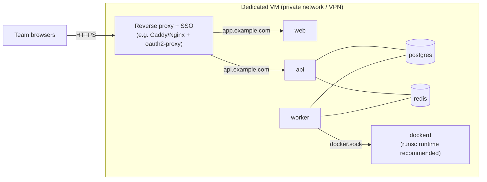
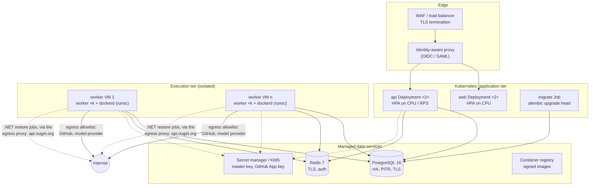

# Deployment guide

How to run the Agentic Dev Platform: on a laptop, on a single host for a team, and as a production deployment. Read the [security model](../security/security-model.md) first. In particular, **the API has no built-in authentication yet**, so every deployment beyond a laptop needs an authenticating proxy in front.

| Option | For | Isolation | Effort |
|---|---|---|---|
| [A. Local (compose)](#a-local-development-docker-compose) | Development, evaluation | Docker sandboxes on your machine | Minutes |
| [B. Single host](#b-single-host-for-a-team) | A small team, internal pilot | Docker sandboxes, SSO proxy, dedicated VM | Hours |
| [C. Production reference](#c-production-reference-architecture) | An organisation | Separate tiers, managed data services, hardened workers | Days |

---

## 1. Prerequisites

| You need | Why |
|---|---|
| Docker Engine 24+ with Compose v2 (or a container platform) | All services and the run sandboxes are containers |
| A GitHub App that **you** register | Lists repos, clones private repos, pushes branches, opens PRs. See [Connecting your platforms](../integrations/connecting-platforms.md#1-github-register-your-own-github-app) |
| An Anthropic API key per workspace | Runs `agent` nodes. Entered in the web app, stored encrypted |
| For B and C: a DNS name and TLS certificates for the web app and the API | The browser calls both |
| For B and C: an identity provider (OIDC/SAML) | Authenticate users at the proxy |

The platform makes outbound calls only to GitHub (`api.github.com`, `github.com`) and your model provider (`api.anthropic.com`), from the API and the workers. The sandboxes make none.

---

## A. Local development (docker compose)

```bash
git clone https://github.com/<you>/agentic-dev.git && cd agentic-dev
cp .env.example .env
docker compose up --build
```

- Web: <http://localhost:3000> · API docs: <http://localhost:8000/docs> · health: `/health`, `/health/ready`
- Agents run on the **fake runtime** by default (scripted, no network, no cost). For real runs set `AGENTIC_RUNTIME=claude` in `.env`, restart, and paste a Claude key in **Settings → Integrations**.
- For GitHub, create a development App (Setup URL `http://localhost:8000/github/setup`), save its key as `.secrets/github-app.pem`, and set `GITHUB_APP_ID` and `GITHUB_APP_SLUG`.
- To try everything without GitHub, set `AGENTIC_GITHUB=fake`: two local demo repos (`e2e-org/docs-demo`, `e2e-org/private-lib`) stand in.

Compose starts: `postgres`, `redis`, `keygen` (creates the master key once in the `secrets` volume), `fixtures` (seeds the fake repos), `api` (runs migrations, then serves), `sandbox-image` (builds the sandbox image), `egress-proxy` (the NuGet egress proxy a .NET restore job reaches, on the internal `agentic-nuget` network), `worker` and `web`. Only the API and web are published to the host.

> Deleting the `secrets` volume deletes the master key: stored model keys become unreadable and must be entered again.

---

## B. Single host for a team

Use a **dedicated VM** (the worker controls its Docker daemon). 4 vCPU and 16 GB RAM run about 8 concurrent agents comfortably; each sandbox is capped at 1 CPU and 512 MB.



Steps:

1. **Harden the host.** Firewall everything inbound except 443 from your network or VPN. Restrict outbound traffic to GitHub, your model provider, your IdP and your package mirrors.
2. **Configure `.env`:**
   ```dotenv
   AGENTIC_ENV=production
   AGENTIC_RUNTIME=claude
   SANDBOX_BACKEND=docker
   POSTGRES_PASSWORD=<long random value>
   GITHUB_APP_ID=<id>
   GITHUB_APP_SLUG=<slug>
   ```
   and in `docker-compose.yml` (or an override file), set the public URLs: `CORS_ORIGINS='["https://app.example.com"]'`, `WEB_BASE_URL=https://app.example.com`, `API_BASE_URL=https://api.example.com`.
3. **Build the web app for your API URL** (it is inlined at build time):
   ```bash
   docker compose build --build-arg NEXT_PUBLIC_API_URL=https://api.example.com web
   ```
4. **Remove development-only mounts** from the worker in an override file: the `./.git:/samples/agentic-dev.git` demo mount and the `fixtures` volume, and leave `SANDBOX_LOCAL_ROOT` unset, so only https repositories can be cloned.
5. **Decide on .NET lint.** `scan.lint` restores and builds C# projects in job containers; the restore reaches `api.nuget.org` through the `egress-proxy` service, whose network (`agentic-nuget`) is internal. Keep the service and the worker's `SANDBOX_NUGET_NETWORK`/`SANDBOX_NUGET_PROXY` to lint .NET repos; remove them, and .NET modules are reported as skipped ("NuGet restore is not configured"), with no sandbox network at all. Allow the proxy's host outbound HTTPS to `api.nuget.org`.
5. **Put both hostnames behind SSO.** Every request to `app.` and `api.` must carry an authenticated session. Example with oauth2-proxy: run it in front of both upstreams with your IdP, cookie domain `.example.com`, and allow only your organisation's group. The GitHub App's Setup URL (`/github/setup`) is opened by the installer's browser, so it is covered by the same session.
6. **Register the GitHub App** with Setup URL `https://api.example.com/github/setup` and Homepage URL `https://app.example.com`.
7. **Optional, recommended:** install gVisor and make `runsc` the Docker daemon's default runtime, so every sandbox gets a user-space kernel. Run the test suite's Docker tests once to confirm the sandbox still works.
8. Start: `docker compose up -d --build --wait`, then open the web app, paste a Claude key and install the App.

---

## C. Production reference architecture



### Tiers

**Application tier (Kubernetes or any container platform).** `web` and `api` are stateless; run two or more replicas behind the proxy. Use the `/health` endpoint for liveness and `/health/ready` (checks Postgres and Redis) for readiness. The API image runs `alembic upgrade head` before serving; with several replicas, run migrations once as a pre-deploy Job with the same image (`alembic upgrade head` in `/app/api`) and override the API command to start `uvicorn` only, so replicas never race on a migration.

**Execution tier (workers).** Workers need a container runtime to create sandboxes. Recommended: **dedicated VMs** (a VM scale set or node group) that each run `dockerd` with gVisor `runsc` as the default runtime, and one or more worker processes. Workers reach Docker through the local socket; nothing else on these VMs. Alternatives:

- Point `DOCKER_HOST` at a dedicated, TLS-protected remote Docker host per worker.
- Do **not** run Docker-in-Docker as a privileged pod in a shared cluster: it gives the pod host-level control.

**NuGet egress (optional).** To lint .NET repos, each worker host runs the egress proxy (`packages/egress-proxy`) on an internal Docker network, as compose does: `docker network create --internal agentic-nuget`, the proxy container on it and on a network with outbound HTTPS to `api.nuget.org`, and the worker started with `SANDBOX_NUGET_NETWORK=agentic-nuget` and `SANDBOX_NUGET_PROXY=http://<proxy container name>:3128`. Restore and build jobs run with 2 GB, 2 CPUs and 512 PIDs by default (`SANDBOX_JOB_MEMORY`, `SANDBOX_JOB_CPUS`). The proxy logs every host it refuses.

Native Kubernetes sandboxes (a `Sandbox` backend that creates pods with a `RuntimeClass` such as gVisor or Kata) are a natural extension of the `Sandbox` protocol; see [Connecting your platforms](../integrations/connecting-platforms.md#6-adding-a-sandbox-backend). Production isolation is roadmap phase 10.2.

**Data tier.** Managed PostgreSQL 16 with high availability and point-in-time recovery; managed Redis with TLS and authentication. Redis holds no system of record, but it is not entirely disposable: it carries the announcements of runs that are queued and not yet claimed, and pending GitHub install states. A run whose announcement is lost stays `queued` until it is rerun (automatic recovery is tracked in [`specs/ideas.md`](../../specs/ideas.md)). Use a managed Redis with persistence, or check for stale `queued` runs after a Redis restart.

### Images

```bash
# Python services (API + worker share one image)
docker build -f packages/api/Dockerfile -t registry.example.com/agentic/python:1.0.0 .
# Sandbox image (scanners, offline vulnerability DB and the .NET SDK baked in, ~1.2 GB)
docker build -t registry.example.com/agentic/sandbox:1.0.0 packages/sandbox
# NuGet egress proxy, if .NET repos are linted
docker build -t registry.example.com/agentic/egress-proxy:1.0.0 packages/egress-proxy
# Web, one build per environment
docker build --build-arg NEXT_PUBLIC_API_URL=https://api.example.com \
  -t registry.example.com/agentic/web:1.0.0 web
```

Run the worker with `python -m agentic_worker` on the Python image, and set `SANDBOX_IMAGE` to the sandbox image by digest. Rebuild the sandbox image regularly: it refreshes the OSV vulnerability database the dependency scanner uses offline.

### Sizing

| Component | Starting point | Scale on |
|---|---|---|
| web | 2 × (0.25 vCPU, 256 MB) | CPU |
| api | 2 × (0.5 vCPU, 512 MB) | CPU, open SSE connections |
| worker | 1 process per 1–2 concurrent runs; VMs of 4–8 vCPU, 16–32 GB | Queue depth (`runs` with status `queued`), waiting time to claim |
| sandbox | 1 per active run, 1 CPU / 512 MB / 256 PIDs each | — |
| job container | During a .NET lint only: 2 CPU / 2 GB / 512 PIDs, one at a time per lint | `SANDBOX_JOB_MEMORY`, `SANDBOX_JOB_CPUS` |
| PostgreSQL | 2 vCPU, 8 GB, 100 GB SSD | Event and artifact volume; connections (each API process holds one `LISTEN` connection) |
| Redis | Smallest managed tier | — |

Each agent run is mostly waiting on the model provider, so CPU per worker is low. The policy limit `agents_alive` (8 by default) bounds concurrency within one run.

---

## 4. Production checklist

Security (see the [security model](../security/security-model.md#6-operator-responsibilities)):

- [ ] Web and API reachable only through an authenticating proxy; no direct access to the API from the internet.
- [ ] `AGENTIC_ENV=production`; `AGENTIC_GITHUB=app`; `CLAUDE_KEY_CHECK=anthropic`; `SANDBOX_BACKEND=docker`; `SANDBOX_LOCAL_ROOT` unset.
- [ ] Unique master key per environment, in a secret manager, mounted read-only, **backed up apart from the database**.
- [ ] Your own GitHub App with minimal permissions, installed on selected repositories; branch protection on default branches.
- [ ] Workers on dedicated hosts; sandboxed container runtime; egress restricted to GitHub and the model provider (and, if .NET repos are linted, the egress proxy's to `api.nuget.org`).
- [ ] Postgres and Redis private, with TLS and strong credentials; no default passwords.
- [ ] `CORS_ORIGINS`, `WEB_BASE_URL`, `API_BASE_URL` and `NEXT_PUBLIC_API_URL` set to your HTTPS URLs.
- [ ] Images built from a tagged release, scanned, and pinned by digest.

Reliability:

- [ ] At least two API and web replicas; at least two workers on different hosts.
- [ ] Migrations run as a single pre-deploy job.
- [ ] Postgres PITR enabled and a restore tested.
- [ ] Alerts on: `/health/ready` failures, runs in `queued` longer than a few minutes, `failed` run rate, Postgres storage.

---

## 5. Operations

### Upgrades

1. Read the [changelog](../../CHANGELOG.md) for migrations and breaking changes.
2. Build and push new images.
3. Run the migration job (`alembic upgrade head`). Migrations are additive where possible; take a database snapshot first.
4. Roll out the API and web.
5. Roll out workers. A worker that receives `SIGTERM` cancels its graph without ending the run and releases its lease, so another worker resumes the run from its last checkpoint. Give workers a termination grace period of at least 30 s.

Runs paused at a gate keep their sandbox container. Do not prune containers labelled `agentic.run_id` while their run is `waiting`.

### Backup and disaster recovery

| What | How | Note |
|---|---|---|
| PostgreSQL | Managed PITR + daily snapshots | Holds everything durable, including encrypted keys |
| Master key | Secret manager with versioning, plus an offline escrow copy | Without it, stored model keys cannot be decrypted |
| GitHub App private key | Secret manager; can be regenerated in GitHub | Regenerating revokes the old key |
| Redis | Persistence on the managed service | Only announcements of unclaimed runs and install states; after a loss, rerun stale `queued` runs |
| Sandboxes | No backup needed | Recreated on resume; artifacts live in Postgres |

Target: RPO = your Postgres PITR window; RTO = time to restore Postgres and start services. Runs that were executing resume from their last checkpoint once workers are back.

### Monitoring

- **Health:** `GET /health` (process up) and `GET /health/ready` (Postgres and Redis reachable).
- **Logs:** structured, with live secrets redacted. Ship them to your log platform; keep worker logs with the run id.
- **Business signals** (SQL on `runs`): queued runs and their age, failure reasons (`failure_reason`), spend per workspace (`estimated_usd`), gates waiting (`status = 'waiting'`) and those close to expiry.
- **Audit:** `GET /workspaces/{id}/audit` or the **Audit** page.
- Distributed tracing (OpenTelemetry) is planned (phase 10.3).

### Troubleshooting

| Symptom | Likely cause | Fix |
|---|---|---|
| Settings says "GitHub App is not configured" | `GITHUB_APP_ID`/`SLUG` or key file missing on the API | Set them; check the key file is mounted and readable by uid 10001 |
| Install returns to `?github=error&reason=state` | Install took more than 10 minutes, or Redis was flushed | Start the install again |
| Runs stay `queued` | No worker running, workers cannot reach Redis/Postgres, or Redis lost the run's announcement | Check worker health and logs; a run whose announcement was lost is not picked up automatically yet: rerun it (see `specs/ideas.md`) |
| Runs fail with a sandbox error | Worker cannot reach Docker, or `SANDBOX_IMAGE` missing | Check `DOCKER_GID`/socket permissions; build or pull the sandbox image |
| .NET modules "skipped: NuGet restore is not configured" | `SANDBOX_NUGET_NETWORK`/`SANDBOX_NUGET_PROXY` unset on the worker | Run the egress proxy and set both (see Execution tier) |
| .NET modules "restore failed: a package source is not reachable" | The proxy cannot reach `api.nuget.org`, or a package is only on a private feed | Check the proxy host's outbound HTTPS and its log; private feeds are not supported yet |
| Runs on Claude fail because the stored key cannot be decrypted | Master key changed or differs between API and worker | Use the same key file on both; restore it, or enter keys again |
| Browser errors calling the API | `NEXT_PUBLIC_API_URL` or `CORS_ORIGINS` wrong | Rebuild web with the right URL; set the origin list |
| PR step fails with permission error | App lacks Contents/Pull requests write, or is not installed on the repo | Fix the App permissions and accept them on the installation |
