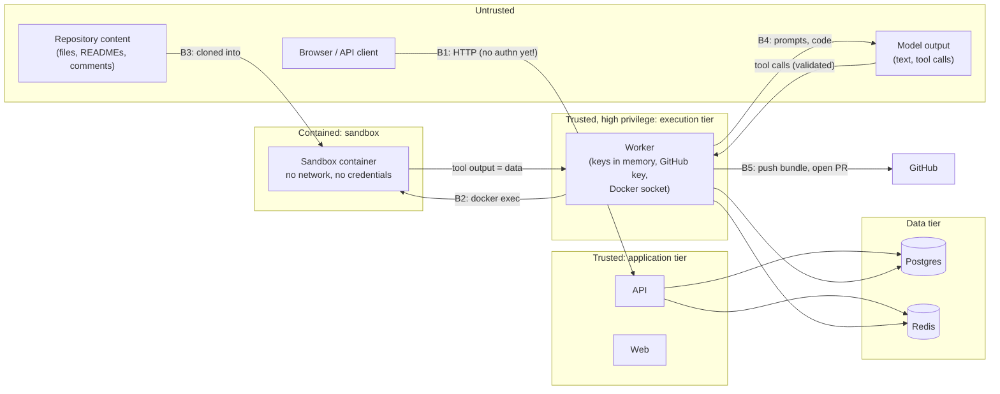

# Security model

This document is for security reviewers, platform operators and contributors. It describes what the platform protects, where the trust boundaries are, which controls exist today, and, just as important, **which do not exist yet**. To report a vulnerability, follow [SECURITY.md](../../SECURITY.md).

> [!WARNING]
> **The API has no user authentication or authorisation yet.** Anyone who can reach the API can read every workspace, store model keys, start runs that spend those keys, approve gates and open pull requests through your GitHub App. Until users, sessions and roles are built, deploy the platform **only** on a private network behind an authenticating reverse proxy. See [§7](#7-known-gaps-and-hardening-roadmap) and the [deployment guide](../operations/deployment.md#4-production-checklist).

---

## 1. Assets

| Asset | Where it lives | Impact if compromised |
|---|---|---|
| Model provider API keys | `connections`, AES-256-GCM encrypted; in worker memory during a run | Spend on the victim's account; access to their provider data |
| Master key | Key file (`MASTER_KEY_FILE`) / KMS | Decrypts every stored model key |
| GitHub App private key | `GITHUB_APP_PRIVATE_KEY_FILE` on API and worker | Mint tokens for every installation: read and write all granted repos |
| Source code of connected repos | Worker clone, sandbox volume, model provider requests, run events and artifacts | Code disclosure |
| Pull requests and branches | GitHub | Malicious code proposed under the App's identity |
| Run history, artifacts, audit log | Postgres | Disclosure; loss of accountability |
| Host running the worker | Infrastructure | With the Docker socket, full host control |

## 2. Trust boundaries

| Boundary | What crosses it | Main controls |
|---|---|---|
| **B1** client → API | All user actions | Input validation (Pydantic), CORS. **No authentication yet**: rely on the network and the proxy. |
| **B2** worker → sandbox | Tool commands and their output | Fixed command shapes, strict tool arguments, sandbox hardening (§4.3), output treated as data |
| **B3** repository → sandbox | Untrusted files | Shallow clone by the worker over https only (other transports refused), no prompts, system and user git config ignored; git in the sandbox runs with hooks and fsmonitor disabled; checkout read-only to agents |
| **B4** worker ↔ model | Instructions, code as input, tool calls | Instructions/data separation; per-node tool grants; output schema validation; policy limits |
| **B5** worker → GitHub | Branches, PRs | Human gate before every push/PR; create-only push; short-lived installation token |

## 3. Threat model (STRIDE)

| Threat | Example | Controls in place | Residual risk |
|---|---|---|---|
| **Spoofing** | A caller acts as another user | None at the application layer yet | **High** until auth ships; mitigate with SSO at the proxy |
| | Forged GitHub install callback links another account's installation | Single-use, 10-minute `state`; installation checked with the App JWT | Medium in multi-workspace setups: see gap G3 |
| **Tampering** | Rewriting history to hide an action | Append-only `run_events`, `run_artifacts`, `workflow_versions`, `audit_events` (DB triggers on the last two) | A database superuser can still alter rows; restrict DB credentials |
| | Agent pushes to `main` or force-pushes | Push may only create `agent/<run>/<node>`; human gate first; platform never merges | Protect `main` on GitHub too |
| | Approver sees one diff, a different one is pushed | Gate commits the approver's edits itself; PR built from those branches | — |
| **Repudiation** | "I never approved that" | Approvals and audit rows written in the change's transaction | `decided_by` / `actor_id` are empty until users exist |
| **Information disclosure** | Model key in logs or events | Encryption at rest, redaction filter, key used only by the run's client, only last 4 chars shown | Process memory on the worker |
| | Secret found by the scanner reaches the report | gitleaks `--redact`; report model has no field for the match | — |
| | Prompt injection exfiltrates code | Sandbox has no network; agents have no network tools | Code is sent to the model provider by design: choose a provider and region per your policy |
| **Denial of service** | Runaway agents or loops spend money | Policy ceilings, optional hard budget, approval TTL, `MAX_ATTEMPTS` | No API rate limiting yet |
| | Fork bomb or memory exhaustion in the sandbox | PID, CPU and memory limits; `noexec` tmpfs | Disk usage of volumes is not capped |
| **Elevation of privilege** | Sandbox escape via a container breakout | Non-root, no capabilities, `no-new-privileges`, read-only root | Shared kernel with the host: use gVisor/Kata (phase 10.2) |
| | Worker compromise → host | — | The worker holds the Docker socket: treat its host as dedicated |
| | Malicious spec runs code | No code in specs; CEL expressions only; fixed tool set | Plugin nodes (10.1) will need their own sandbox |

## 4. Controls

### 4.1 Secrets

- **Envelope encryption.** A per-workspace 256-bit data key, wrapped by a master key behind a `KeyProvider` protocol. Secrets are encrypted with AES-256-GCM, a random 96-bit nonce, and associated data `agentic-secret:<workspace>:<connection>:<provider>`, so a ciphertext moved to another row fails to decrypt.
- **Minimal exposure.** A key is verified once with the provider before it is stored; only its last four characters are ever returned. It is decrypted when a run starts, held in a `SecretStr`, used only by that run's client, and registered with the redactor while held.
- **Redaction.** `RedactingFilter` on log handlers and `redact()` on event payloads replace any live secret (8+ characters) with `[REDACTED]`. A test fails the build if a key appears in a run's events or logs (`test_no_secret_leak.py`).
- **No personal tokens.** GitHub uses an App; installation tokens are short-lived and minted on demand. The token reaches git through environment variables only, never argv, URLs or files.
- **Fakes are refused in production.** `AGENTIC_ENV=production` refuses the fake GitHub App and the fake key check.

### 4.2 Agents and prompt injection

Repository content, earlier outputs, tool results and user text are **data**, never instructions:

- Role and instructions form the system prompt; the run's input is placed in a user turn inside an `<input>` block marked as data; tool results are `tool_result` blocks.
- The only user-written text in a template's instructions (`extra_instructions`) is set apart in its own block.
- Tools are granted per node. Audit agents get read-only tools. Arguments are validated strictly; unknown arguments are refused.
- Typed outputs are validated against JSON Schema with local references only, so validation never fetches a URL.
- Even a fully hijacked agent can only: read the repo copy, write on its own branch inside the sandbox, and produce text. Anything leaving the sandbox goes through a human gate.

### 4.3 Sandbox

| Setting | Value |
|---|---|
| Network | `none` |
| Root filesystem | read-only |
| Capabilities | all dropped |
| `no-new-privileges` | on |
| User | non-root sandbox user (uid 1000) |
| `/tmp` | tmpfs, `noexec,nosuid`, 64 MB |
| Limits | memory, CPU and 256 PIDs per container |
| Checkout | owned by root: readable, not writable, by agents |
| Writers | one git worktree and branch each; git runs with a fixed safe configuration |
| Image | Alpine pinned by digest; scanners pinned and verified by sha256; offline OSV database |
| Lifecycle | labelled `agentic.run_id`; removed at run end; a fresh sandbox per resumed attempt |

### 4.4 Data integrity and audit

- Append-only tables with database triggers refusing `UPDATE`/`DELETE` on `workflow_versions` and `audit_events`.
- Audit entries are written in the same transaction as the change: one exists if and only if the change was committed.
- Every run keeps its exact spec, workflow version, frozen limits and logged prices.

### 4.5 Supply chain

- `uv.lock` and `pnpm-lock.yaml` are committed; CI installs with `--frozen` / `--frozen-lockfile`.
- Sandbox scanners are downloaded at build time from pinned releases and checked against sha256 digests for amd64 and arm64.
- Python services run as uid 10001 and the web server as `node`, both non-root.
- Generated artifacts (JSON Schemas, OpenAPI client) are checked for drift in CI.

## 5. Data flows to third parties

| Data | Sent to | When |
|---|---|---|
| Repository source code, file listings, scanner findings, agent instructions | The workspace's model provider (Anthropic) | Every agent turn |
| Branches and pull request text | GitHub | After an approved gate |
| Repository list and metadata | Read from GitHub | Listing repos, cloning |

The platform sends no telemetry to the project or to any third party. Next.js telemetry is disabled in the image.

## 6. Operator responsibilities

The platform cannot secure these for you:

1. Put API and web behind an **authenticating** reverse proxy (OIDC/SAML SSO) on a private network.
2. Generate a unique master key per environment, store it in a secret manager, and **back it up apart from the database**.
3. Register **your own** GitHub App with the least permissions you need, install it on chosen repositories only, and protect default branches with required reviews.
4. Run workers on dedicated hosts or nodes; prefer a sandboxed container runtime (gVisor `runsc` or Kata) and restrict worker egress to GitHub and your model provider.
5. Change all default credentials (`POSTGRES_PASSWORD`), enable TLS to Postgres and Redis, and keep both off the public network.
6. Set `AGENTIC_ENV=production` and leave `AGENTIC_GITHUB` and `CLAUDE_KEY_CHECK` at their real values.
7. Rotate the GitHub App private key and model keys on your usual schedule; keep the audit log.

## 7. Known gaps and hardening roadmap

| ID | Gap | Severity today | Mitigation until fixed | Planned fix |
|---|---|---|---|---|
| G1 | No users, sessions or roles; every endpoint is open | **Critical** if exposed | Private network + SSO proxy; restrict who can reach the API | Users and auth phase (see [`TODO.md`](../../TODO.md) §1) |
| G2 | Approvals and audit entries have no actor | Medium | Proxy access logs | With G1 |
| G3 | `/github/setup` checks the installation belongs to the App, not that the browser user can access it | Low with one workspace; medium with several | Single workspace; trusted users only | OAuth during install + `GET /user/installations` check (`TODO.md` §2) |
| G4 | Installation tokens cover every repo of the installation with all App permissions | Medium | Install the App on few repos; minimal App permissions | Per-run tokens scoped to one repo and the permissions needed (`TODO.md` §3) |
| G5 | Worker uses the host Docker socket | High (host-level privilege) | Dedicated VM/node for workers; rootless Docker or a sandboxed runtime | Production isolation with gVisor/Firecracker (phase 10.2) |
| G6 | Worker egress is unrestricted | Medium | Network policy / firewall to GitHub and the provider | Egress allowlist (phase 10.2) |
| G7 | No API rate limiting or request size limits beyond defaults | Medium | Limits at the proxy | Not yet planned |
| G8 | No retention policy for events, artifacts and checkpoints | Low | Manual archival | Not yet planned |
| G9 | Master key is a local file | Medium | File from a secret manager, mounted read-only | Cloud KMS `KeyProvider` (phase 10.5) |
| G10 | No distributed tracing for incident response | Low | Structured, redacted logs | OpenTelemetry (phase 10.3) |
